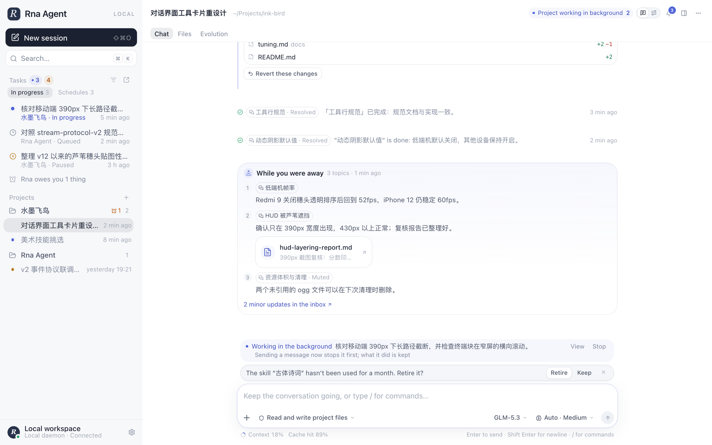
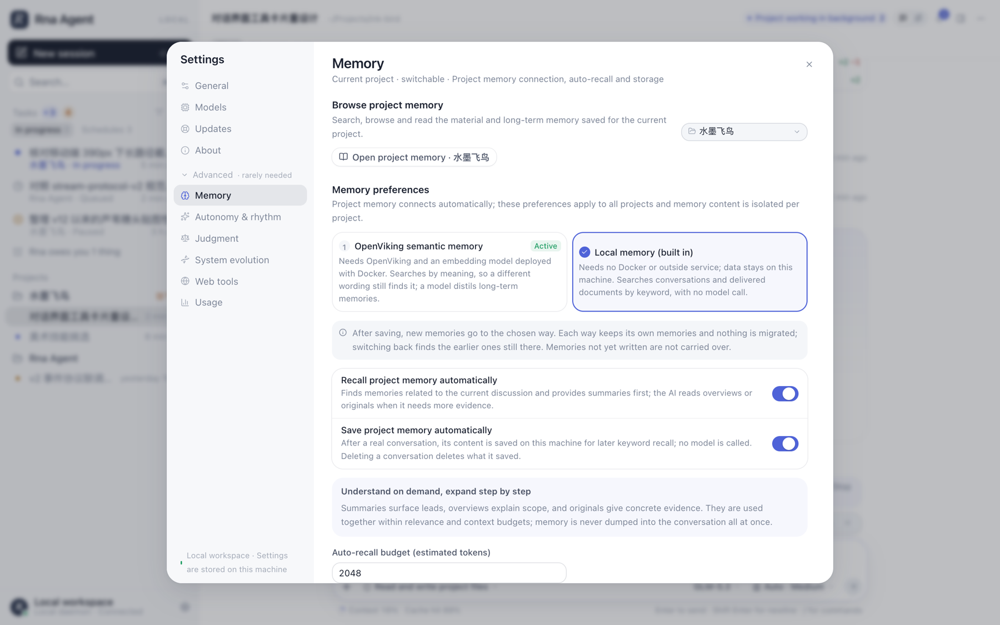
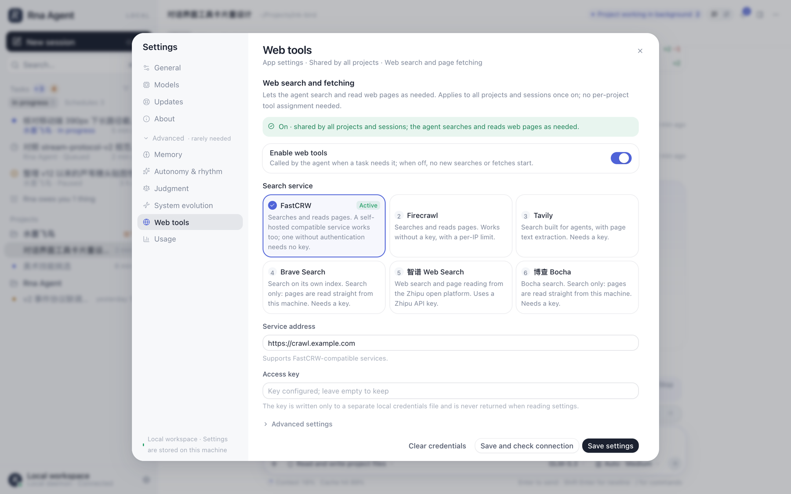

<div align="center">

**English** · [简体中文](README.zh-CN.md)


# Rna Agent

### A local-first AI agent workbench for long-running projects.

**Projects, not chats. An agent that keeps working in the background, remembers what happened, and tells you when it matters.**

[](https://github.com/skingko/rna_dev/actions/workflows/ci.yml)
[](https://github.com/skingko/rna_dev/releases/latest)
[](https://github.com/skingko/rna_dev/releases)
[](LICENSE)


[Download](#download) · [Why Rna](#why-rna) · [Features](#features) · [Quick start](#quick-start) · [Memory](#memory-with-or-without-docker) · [Web search](#web-search-six-services-one-pair-of-tools) · [Architecture](#architecture) · [FAQ](#faq) · [Docs](#documentation)

<br />

<picture>
  <source media="(prefers-color-scheme: dark)" srcset="docs/assets/workbench-dark.png" />
  
</picture>

</div>

---

Rna Agent is a desktop app and command line for working with AI agents on projects that last longer than one conversation: a game, a novel, a research topic, a codebase. You create a project, give it a folder and an introduction, and the agent keeps context across sessions, works in the background when it has something worth doing, and brings you back a short summary instead of a wall of logs.

It runs on your machine. Your projects, conversations, memory and keys stay in local files; the only network traffic is to the model and search services you configure.

## Download

Get the build for your system from the [latest release](https://github.com/skingko/rna_dev/releases/latest).

| Platform | File | Status |
| --- | --- | --- |
| macOS, Apple silicon | `Rna-Agent-<version>-macOS-arm64.dmg` | Supported |
| macOS, Intel | `Rna-Agent-<version>-macOS-x64.dmg` | Supported |
| Linux, x64 | `Rna-Agent-<version>-Linux-x64.tar.gz` | Preview |
| Windows, x64 | `Rna-Agent-<version>-Windows-x64.zip` | Preview |

Every release is built by [GitHub Actions](.github/workflows/release.yml) and started once on its own platform before it is published. The builds are not code-signed or notarized yet, so macOS and Windows ask for confirmation the first time you open the app (see the [release notes](.github/release-notes.md) for the one-line workarounds).

macOS is where Rna is developed and used every day. Linux and Windows builds run the same code; features that rely on macOS facilities (the command sandbox, the background service manager) are reduced there. Reports from those platforms are very welcome.

## Why Rna

Most agent tools are a chat box attached to a model. Rna is built around the parts that matter when work spans days:

- **A project is the unit, not a conversation.** Projects own a folder, a memory, a set of skills and tools, a schedule and a history. Sessions come and go inside them.
- **The agent can work while you are away, and says so.** Background investigation, scheduled work and follow-ups run under explicit rules; when you return you get a *while you were away* summary, and a message you send interrupts background work first, keeping what it did.
- **Memory that needs nothing installed.** Choose the built-in local memory and conversations and delivered files are searchable on your machine at once; connect an [OpenViking](https://github.com/volcengine/OpenViking) server when you want semantic search.
- **A cheap judge in front of the expensive model.** Routing, "is this worth interrupting you for", "does this need memory" and similar yes/no questions go to a small judgment model (JEV, about a thousandth of the main model's cost) *before* the main model writes anything.
- **Changes are measured, not assumed.** Candidate changes to a project's own behavior are evaluated against a frozen baseline and adopted only when they clear explicit gates, with a visible history and one-step revert.

## Features

| | |
| --- | --- |
| **Projects and sessions** | Project folders, per-project capability assignment, archive / restore, deletion that also clears the evidence it produced, session worktrees for isolated edits |
| **Models** | DeepSeek, GLM (Zhipu), OpenAI-compatible endpoints, Anthropic via API key, ChatGPT subscription sign-in; per-session model and reasoning level, automatic reasoning level |
| **Tools** | Project file read / write / edit, command execution with a sandbox on macOS, a terminal, a side-panel browser, file preview with live reload, git status and worktrees |
| **Skills and MCP** | On-demand skills, a skill marketplace (ClawHub, skills.sh), stdio and Streamable HTTP MCP servers, per-project assignment and permission levels |
| **Memory** | Built-in local memory or OpenViking, automatic recall within a token budget, a memory browser, memory kept per project and removed with the conversation it came from |
| **Web** | Search and page reading through FastCRW, Firecrawl, Tavily, Brave, Zhipu or Bocha |
| **Proactive work** | Background investigation, schedules, "while you were away" summaries, adaptive pacing that follows how you respond, an emergency stop for everything |
| **Evolution** | Per-project gene tree of behavior rules, evaluated candidates, a system evolution page that shows tool failures by cause |
| **Operations** | Background service with crash recovery, restore points, in-app update with rollback, a CLI that talks to the same service |
| **Interface** | English and Simplified Chinese, light and dark themes, keyboard-first |

## Quick start

### From a release

1. Download the file for your platform and open it (macOS: drag **Rna Agent** to Applications).
2. **Settings → Models**: add a provider and its key, then pick a default model.
3. **Settings → Memory**: choose **Local memory (built in)** for no setup, or connect OpenViking.
4. Optional: **Settings → Web tools** to let the agent search and read pages.
5. Create a project, point it at a folder, and start a session.

### From source

Requires Node.js 22.19 or newer. The host and the SDK have no runtime dependencies.

```bash
git clone https://github.com/skingko/rna_dev.git
cd rna_dev/prototypes/control-center

# build the web UI once
npm ci --prefix web && npm run build --prefix web

# start the local service, then open http://127.0.0.1:4317
./rna start
```

Run the desktop shell from source (Electron):

```bash
cd prototypes/control-center/desktop
npm ci && npm start
```

### Command line

The `rna` command talks to the same service and the same projects as the app.

```bash
./rna help                       # everything it can do
./rna config                     # redacted configuration and the model catalog
./rna memory-config --backend embedded
./rna web-config --provider firecrawl --enabled true && ./rna web-test
./rna chat --workspace "$PWD"    # an interactive session in the current folder
```

## Memory, with or without Docker

Rna keeps project memory in one of two ways, chosen in **Settings → Memory**. They keep separate memories and do not migrate into each other; switching back brings the old memory back.

| | OpenViking semantic memory | Local memory (built in) |
| --- | --- | --- |
| Needs | Docker, OpenViking, an embedding model, a text model | Nothing |
| Search | By meaning: a different wording or language still finds it | By keywords (Chinese by character pairs) |
| Conversations | Distilled into long-term memories by a model | Kept as they were said, no model call |
| Data | The OpenViking service's volume | `<state>.rna/memory/embedded.sqlite` on this machine |

The built-in engine answers the same requests the host sends an OpenViking server, so recall, the memory tools, the browser and conversation deletion run the same code on either backend. Replayed over 100 real searches, an earlier turn of the same conversation ranked first in 90% of cases and within the top five in 98%; the [write-up](docs/embedded-memory.md) also says what keyword search cannot do.

## Web search: six services, one pair of tools

The agent always sees the same two tools, `web_search` and `web_fetch`. Which service answers is a setting.

| Service | Search | Reads pages | Key |
| --- | --- | --- | --- |
| [FastCRW](https://fastcrw.com) (default; self-hosted compatible) | yes | via the service | optional |
| [Firecrawl](https://www.firecrawl.dev) | yes | via the service | optional, rate-limited without one |
| [Tavily](https://tavily.com) | yes | via the service | required |
| [Brave Search](https://brave.com/search/api/) | yes | from this machine | required |
| [Zhipu Web Search](https://open.bigmodel.cn) | yes | via the service | required |
| [Bocha](https://bochaai.com) | yes | from this machine | required |

Services that only search have pages read directly from your machine: anonymous requests to public addresses only, with the connection pinned to the address that was checked, every redirect hop re-checked, and no key sent. Choosing another service switches to that service's address and clears the saved key, so a key is never sent to a service it was not saved for.

<div align="center">
  
  
</div>

## Architecture

```text
┌──────────────── desktop shell (Electron) ────────────────┐
│  workbench UI (React, Vite)   ◄── HTTP + SSE ──►  CLI    │
└───────────────────────────────┬──────────────────────────┘
                                │ 127.0.0.1 only
┌───────────────────────────────▼──────────────────────────┐
│ host service  prototypes/control-center  (Node ESM)      │
│   projects · sessions · memory · schedules · evolution   │
│   background supervisor · maintenance · restore points   │
├──────────────────────────────────────────────────────────┤
│ Rna SDK  packages/sdk  (Node ESM, no dependencies)       │
│   agent loop · tools · MCP · decision kernel (JEV) ·     │
│   web providers · evaluation · prompt layers             │
└───────────────┬──────────────────────┬───────────────────┘
                │                      │
     model providers            memory: built-in SQLite
     (your keys, local file)    or an OpenViking server
```

- The service listens on `127.0.0.1` only. Keys are stored in a separate local credentials file (mode 600) and are never returned by the API or written to project files.
- Judgments go through one decision kernel with typed questions, per-question thresholds, a cache and a ledger; the model writes only after the judge has been asked.
- State is a sharded local store with checkpoints, so an update can be rolled back and a crash does not lose a conversation.

## FAQ

<details>
<summary><strong>Does my data leave my machine?</strong></summary>

Projects, conversations, memory and credentials are local files. Rna sends requests only to the model providers, search services and MCP servers you configure, and to the JEV judgment service if you enable it. There is no Rna server, and nothing is reported back to the project.

</details>

<details>
<summary><strong>Do I need Docker?</strong></summary>

No. Choose the built-in local memory. Docker is only needed for the OpenViking backend, which adds semantic search and model-distilled memories.

</details>

<details>
<summary><strong>Which models can I use?</strong></summary>

Anything reachable through an OpenAI-compatible endpoint, plus DeepSeek, GLM, Anthropic (API key) and a ChatGPT subscription. Models are added in Settings → Models; the model list is read from the provider, and models you remove stay removed.

</details>

<details>
<summary><strong>How is this different from an IDE agent or a chat client?</strong></summary>

An IDE agent works inside one editor session. A chat client holds one conversation. Rna holds a *project*: its folder, its memory, its schedule and its history, with an agent that can keep working between your sessions and report back.

</details>

<details>
<summary><strong>Is the self-evolution real?</strong></summary>

It is a measured process, not a promise. Candidate changes to a project's behavior are scored against a frozen baseline and adopted only when they pass explicit improvement, safety and cost gates; the history and the failures are visible. Rna does not claim a general quality gain.

</details>

<details>
<summary><strong>Why are the Linux and Windows builds "preview"?</strong></summary>

The code is the same, but development and daily use happen on macOS. The command sandbox and the OS service manager are macOS-specific, so on Windows the background service runs only while the app is open. Each build is started once in CI on its own platform before release.

</details>

## Documentation

| Document | Contents |
| --- | --- |
| [Built-in local memory](docs/embedded-memory.md) | How it works, measurements, limits |
| [OpenViking deployment](docs/openviking-local.md) | Docker setup for semantic memory (Chinese) |
| [SDK guide](packages/sdk/README.md) | API and usage examples |
| [SDK architecture](docs/rna-sdk.md) | Design, sources and boundaries (Chinese) |
| [System design](docs/master-design.md) | Product, architecture, scheduling, caching, memory, evolution, security (Chinese) |
| [Specifications](docs/specs) | Control API and storage, stream protocol, context and capabilities, evolution and evaluation (Chinese) |
| [Operations](docs/operations) | Application maintenance, continuous runtime, recovery (Chinese) |
| [Agent working notes](AGENTS.md) | Conventions for coding agents working in this repository |

## Contributing

Issues and pull requests are welcome; see [CONTRIBUTING.md](CONTRIBUTING.md). Report security problems privately as described in [SECURITY.md](SECURITY.md).

```bash
# SDK tests
cd packages/sdk && node --test test/*.test.mjs
# host tests
cd prototypes/control-center && node --test
# web: typecheck + tests
cd prototypes/control-center/web && npm run typecheck && npm test
```

## Acknowledgements

Rna studies and borrows ideas from [Pi](https://github.com/earendil-works/pi), [Headlong](https://github.com/laude-institute/headlong), [OpenViking](https://github.com/volcengine/OpenViking), the [DeepSeek harness](https://github.com/deepseek-ai/deepseek-harness), [mu](https://github.com/qybaihe/mu), [RRSI](https://github.com/google-research/rrsi), [ZCode](https://github.com/zai-org/ZCode) and [ModularRSI](https://github.com/IQuestLab/ModularRSI). The pinned revisions that were read are listed in [references/manifest.json](references/manifest.json); no source from them is vendored here.

## License

[Apache License 2.0](LICENSE).
