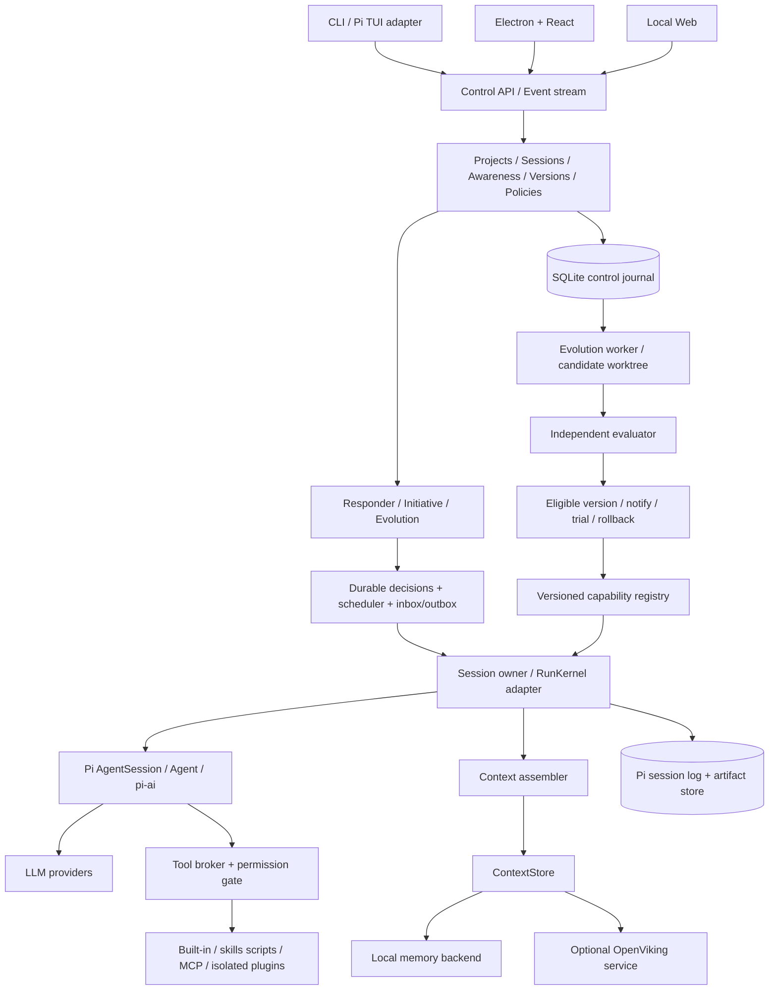
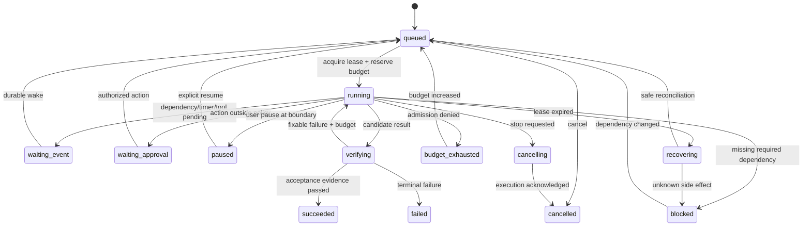

# Rna Agent：以项目为中心的主动协作与自主进化系统

版本：设计基线 v0.4 · 2026-09-24 · 项目主动性模型修订 · 工作名称，可后续更名。

本文是目标系统规格，不表示功能已经实现。当前交付包括上游源码快照、源码审计、技术规格、排期与可运行的交互验证原型。当前独立 SDK 与 daemon 实施状态以 [Rna SDK](rna-sdk.md) 为准；本文未实现部分仍为目标规格。

> 2026-09-24 实施修订：执行内核改为独立 Rna SDK，OpenViking 为唯一记忆服务。后续章节关于 Pi SDK 接入的旧接口仅保留研究背景，不能覆盖此决策；新接口见 [SDK 实施文档](rna-sdk.md)。

## 1. 产品定义与核心决策

Rna Agent 是本地优先、以项目为持久主体、以持续对话为协作界面的主动 Agent 平台。AI 持续理解项目变化、用户讨论、关注事项和未兑现的承诺，自行判断何时行动、沟通、学习或保持沉默；主动性不以用户先设定 Goal 为前提。用户随时自然插话、纠正方向、排队补充或停止某项行动，前台交流与后台研究可以并行。项目还会在既有范围和预算内自主产生、评测新能力版本，证据达标时主动在相关会话提醒可试用更新。CLI、桌面与本地 Web 访问同一项目和持久会话。

产品的完整主轴和交互契约见 [项目主动系统规格](specs/project-proactive-system.md)。这里的“持续”是项目状态、事件感知和行动能力持续存在，不代表模型必须不停调用，也不代表每次唤醒都要向用户发送消息。

首要场景是围绕当前项目持续开展代码开发、研究与资料整理、文件工作流。成功标准同时包括有用的主动发现、承诺兑现、及时交流、能理解并执行用户修正、适当沉默、可验收工作和经独立评测保留的能力增益；不能以自动执行次数或主动发言数量衡量智能。

| 决策 | 采用方案 | 理由与边界 |
|---|---|---|
| 执行核心 | 自有 `@rna-agent/sdk`，参考 Pi / Harness / Headlong 的源码机制 | 不依赖 Pi SDK；自有 provider/session/journal/capability/initiative/evolution，缓存收益须单独基准验证 |
| 控制平面 | 自有 Node/TypeScript daemon，SQLite 项目、会话与事件数据库 | 项目事实、关注项、承诺、决策、预算、版本与多客户端跨会话管理；不把实验协议当产品稳定接口 |
| 主动性 | 项目意识 + Responder / Initiative / Evolution 三通道 | 借鉴 Headlong 自主选择行动、分享、学习和等待；Goal 可选，事件提供思考机会，模型决定是否行动 |
| 记忆 | OpenViking 唯一后端 | 服务不可用时明确报错，不回退本地记忆；会话日志、草稿和项目配置不属于记忆检索库 |
| 自进化 | 项目证据自动触发 skills / workflow / tool adapter / prompt 版本演进 | 自主生成与评测，符合门槛后主动建议试用；通知、试用、正式采用分别建模；固定模型权重 |
| UI | 会话为主的 React 工作台 + Electron 宿主；CLI/TUI 为同等能力入口 | 常驻输入、对话内过程/工具/产物、按需资源侧栏；daemon 生命周期独立于窗口 |
| 插件 | 版本化能力接口、受控生命周期和隔离 worker | 借鉴 DeepSeek Harness 的组合思想；内核政策、凭据和评测器不能由候选版本覆写 |
| 第一发布平台 | macOS；随后 Linux CLI/daemon，Windows 桌面 | 先收敛发行、沙箱、进程树和文件系统差异；跨平台不只更换打包命令 |

**关于 Pi 缓存：**源码可以证实其细致的缓存控制与预热实现，但本次未运行付费 API 比较实验，不能认定其在所有同类项目中最强。项目将“保留 Pi 缓存收益”设为回归门禁，比较同模型、同输入、同任务、同预算下的真实费用与成功率。

## 2. 证据与适用范围

研究按固定提交进行；完整 SHA、采集时间、许可证和本地路径见 [源码清单](../references/manifest.json)。三个指定项目均已克隆，额外克隆用户确认的 DeepSeek Harness 用于 UI/插件结构核查。

| 来源 | 重点参考 | 深读位置 |
|---|---|---|
| Pi | provider/request/context/cache、AgentSession、durable、协议与TUI | 源码审计、[集成与缓存规格](specs/pi-integration-and-cache.md) |
| Headlong | dispatcher、自主退避、消息、递归调用、轨迹投影 | 源码审计 |
| OpenViking | 分层上下文、记忆提交、检索、技能演进、ACL | 源码审计 |
| DeepSeek Harness | 持续会话、运行中输入、过程折叠、composer 接管、资源生命周期 | 深入交互审计、插件对照 |
| ASPIRE | 模糊目标、自建代理指标与外部评测的分离 | 论文核对、[进化规格](specs/evolution-and-evaluation.md) |

本文中的默认预算、SLO、评测门槛、排期是本方案的工程建议，均不是上游性能承诺或论文已经验证的数字。源码研究以静态分析为主，未安装和运行四个上游完整应用。

## 3. 用户路径与完成定义

### 3.1 一次性执行

进入项目并选择工作区 → 在会话中描述需求 → 阅读进展并随时补充/转向 → 查看对话内工具活动、差异与测试 → 获取可审查交付物 → 继续下一轮。普通请求不要求先填写任务表单或确认目标；缺少关键约束时在当前会话澄清，超出既有授权的操作在当前会话请求具体审批。已在工作区政策中授权的可逆动作自动执行。

示例：“修复支付页面的回归，跑相关测试，开草稿 PR”。成功必须包含定位结果、文件差异、验证结果与草稿 PR 标识；只有 Agent 自述完成不成立。没有网络或凭据时，先完成本地修改和验证，任务停在明确缺少依赖的步骤。

### 3.2 项目持续主动工作

用户建立项目并选定工作区后，项目拥有观察范围、预算、行为与提醒偏好。即使没有 Goal，项目事件、交流中暴露的问题、未兑现的承诺和环境变化也可以触发模型判断。模型自主选择调查、执行、分享新发现、召回知识、反思、学习或等待。用户不需要为每次调查和学习下命令；没有新证据时不制造忙碌或状态消息。

明确的长期需求仍可形成可选 `GoalContract`，例如“持续提高发布可靠性”。Goal 增加验收和期限，不是主动能力开关。每个主动动作追溯到项目、证据、关注项/承诺及决策，goalId 可以为空。扩大目录、外部联系人、开支或权限需要既有政策覆盖；模型自行提出意图不等于用户已经授权。

### 3.3 从经历中改进

项目中的反复纠正、工具失败、成功经验或环境变化 → 自动聚合证据并判断学习价值 → 自主提出能力假设 → 创建项目候选版本 → 用冻结基线和独立样本比较 → 达标后在相关对话主动说明改进并邀请试用 → 跟踪新任务结果并保留或回退。用户不必逐步触发这条研究链。提醒不等于安装；按预先授权可自动试用的范围单独执行。界面保留失败候选和全部费用，不只展示幸存版本。

### 3.4 中断与多入口

CLI 发起一轮工作后关闭终端，桌面仍可进入同一会话查看和继续；关闭桌面窗口不停止已授权后台任务。运行中输入明确区分 queue（当前轮后处理）与 steer（下一个可接收执行边界处理），停止本轮、暂停长期目标与全局急停分别建模。重启 daemon 后重建状态并判断未完成调用是否可安全重试；不能将“没有拿到返回值”直接解释为“外部操作没有发生”。

### 3.5 交互对象与执行对象

`Project → Session → Turn` 是用户交互结构；Project 管理一个或多个 Workspace、项目事实、关注项、承诺、偏好及版本。一个 Session 持续保存多轮输入、进展、结果与草稿，一轮结束不终结会话，关闭会话不结束项目主动性。`Project → Decision → Run → Step` 是自主执行结构；Goal 是可选关联，不是根。Run 记录 lane、证据、调度、预算、恢复与工具副作用，并通过 sessionId/turnId/replyTo 与交流关联。后台可以自行发起工作和有归属的助手消息，不构造虚假的用户 prompt；多个通道通过统一发布器避免重复回答。

## 4. 总体架构



### 4.1 四类进程

1. **产品 daemon**：API、任务调度、账本、批准记录、恢复、插件注册元数据。默认本机；负责单写与任务所有权。
2. **运行 worker**：每个工作区或隔离域运行 Pi session；模型请求、工具执行均带 runId、权限租约和预算预留。可信内置扩展可进程内加载；不可信插件必须在受限沙箱/容器或VM中运行，普通子进程本身不构成权限隔离。
3. **上下文服务**：可选 OpenViking。通过受限凭据和命名空间接入，不拥有任务状态、授权记录或正式发布指针。
4. **进化/评测 worker**：候选者只读批准的经历副本，只写候选目录。评测器使用不同身份/文件挂载，持有隐藏集；候选无法读取其题目、答案、日志或密钥。

前端为投影：按钮发命令，daemon 返回事件；不得由 UI 本地状态判定真正的运行状态。窗口断开不会直接触发取消任务。

### 4.2 模块与仓库建议

```text
apps/cli/                 命令行和交互TUI
apps/desktop/             Electron宿主、安装更新、系统权限
apps/web/                 React工作台
packages/contracts/       命令/事件/版本化schema
packages/control/         projects、sessions、concerns、commitments、versions、budget
packages/scheduler/       三lane、decision、durable inbox、leases、timers
packages/awareness/       证据、项目快照、相关性、沉默与通知策略
packages/runtime-pi/      固定Pi SDK适配
packages/context/         上下文计划、ContextStore接口
packages/context-local/   SQLite/文件后端
packages/context-viking/  OpenViking HTTP桥
packages/capabilities/    skills/tools/MCP registry
packages/tool-broker/     权限、幂等、worker执行
packages/evolution/       candidate、实验、晋级、回退
packages/evaluator/       独立执行入口与数据权限
packages/observability/   usage、成本、trace、审计导出
packages/ui/              共享组件和事件投影
evals/                    可公开开发集；隐藏集不在普通工作树
```

### 4.3 技术选型

正式产品采用 TypeScript 严格模式和固定依赖锁；本次Pi基线要求Node ≥22.19.0，具体发行版本在 W1 对 Pi 原生模块及 Electron 打包验证后锁定。当前原型仅依赖 Node ≥20，不等同于最终运行时选择。前端选 React、虚拟列表、代码/差异编辑器、PTY终端组件；避免为第一版引入分布式工作流引擎和消息队列集群。

本地控制数据采用 SQLite WAL；金融式预算预留、外部副作用意图、晋级指针等关键事务使用更强持久化设置并验证断电语义。大文件按内容哈希存储，数据库保存引用。若未来多机器调度，再替换控制存储和租约实现，不能把单机 SQLite 放进共享网络目录当多节点数据库。

## 5. Pi 复用策略

### 5.1 MVP 使用完整会话 SDK

正式调用链是产品 `RunKernel` → Pi `createAgentSession` / `AgentSession` → Pi agent loop → Pi provider。保留上游现有缓存参数、请求序列、系统段、工具语义、压缩和 usage 处理；通过公开扩展点增加预算检查、工具代理与事件观察。

公开事件观察不等于持久化屏障：当前 `AgentSession.subscribe` 不等待异步listener，且先发送 `message_end` 再追加对应会话记录。产品先持久化输入和工具intent，在检查点核对Pi entry/文件状态并flush自己的事件队列。首次assistant前Pi也可能尚未flush初始会话，恢复不能只依赖UI看过的事件。

只导入 `pi-ai` 能复用 provider，但不会自动得到 coding-agent 的缓存预热器。新的 `AgentHarness` / durable 路线也必须单独移植并验证缓存行为，因此不作为“免费升级”的默认路线。[依据与适配细节](specs/pi-integration-and-cache.md)

### 5.2 外层负责产品语义

产品控制平面负责项目事实、关注项/承诺、自主决策、持续会话与Turn索引、可选Goal、排期、租约、预算和发布指针。Pi 会话负责模型对话和工具轮次；产品 Session 在多轮 Run 之间保留 Pi 会话关联和稳定上下文，避免每次发送重建会话损失连续性与缓存。每个 Pi session 只有一个 owner；CLI和桌面都是 client，不能分别打开同一会话写入。每个子 Agent 有独立 session、子预算和收敛产物，主会话可查看其谱系及过程，模型只注入结构化结果和必要证据。

会话单writer并不等于工作区单writer。并行编码任务默认使用独立git worktree/分支或目录快照，集成时校验基线commit与文件hash；共享目录写入使用资源级互斥与版本前置条件。用户同时编辑造成冲突时保留两份证据并重新合并，不由Agent覆盖用户改动。

工具入口不能绕过产品 broker：内置 Bash、read/write/edit、插件命令、MCP、技能脚本都必须应用同一身份、目录和网络策略。Pi 原生扩展在宿主执行代码，不是天然沙箱；自动安装候选扩展之前先在隔离环境加载。

默认resource loader必须显式限制可加载的扩展与skills快照，不能自动执行工作区或用户目录里的任意Pi扩展。控制数据库、凭据、正式skill registry和隐藏评测集放在工具sandbox不可写的独立数据域；仅在prompt中禁止编辑这些路径不足以建立隔离。

### 5.3 升级与 fork 原则

默认锁包+薄适配器；仅当公开API无法满足且上游不可及时解决时维护小型补丁，并记录补丁原因、行数、归还上游计划。每次升级跑请求快照、缓存成本、压缩、恢复和工具取消测试。禁止自动跟随上游 main；禁止进化 Agent 自行升级核心依赖或更改锁文件。

## 6. 自主执行与主动性

### 6.1 项目意识与三条通道

| 通道 | 输入 | 自主行为 | 调度约束 |
|---|---|---|---|
| Responder | 当前用户消息、澄清/审批、项目事实 | 自然回应、理解修正、移交承诺；无必要可不重复回答 | 用户优先，保留响应预算，不等待后台长任务 |
| Initiative | 项目变化、关注事项、承诺、已有行动结果、时间复查 | 自主选择行动、分享、反思、召回、学习或等待；不要求 Goal | 项目准入、资源租约、通知去重、静默时间和退避 |
| Evolution | 项目经历、重复纠正/失败、成功模式、环境变化 | 自主选择缺口、生成候选、评测、跟踪版本；由统一发布器通知 | 隔离工作树、独立预算/评测、固定可信基础 |

项目默认持续观察，并在设定的资源范围内自主判断；用户可分别暂停主动工作、暂停进化或静音提醒。无事件且没有需复查的关注项时不调用模型。Goal 是其中一种明确需求，系统不会因 Goal 为空就失去主动性。规则负责证据去重与资源准入，正式模型根据项目状态决策；原型的确定性 adapter 必须显示为模拟。

项目快照包含观察、证据、关注点、承诺、偏好、活跃动作和版本。输入变化触发重新判断，行动不是按预定阶段无条件往下走。用户修正使相关旧决策失效；下个安全边界重新校验政策和资源版本。Responder 和后台 worker 使用独立 Pi session 与 owner，以控制事件协作，不能并发写同一模型会话。

主动消息投递到相关会话，携带 origin/decisionId/evidenceIds/replyTo，保持正常助手叙事；不需要公开内部推理，也不逐次播报心跳。新发现优先于状态噪声；内容重复、证据不足、时机不合适时等待。项目收件箱接住暂不适合打断当前话题的结果，消息回执和承诺状态持久化。

### 6.2 运行状态



这里的状态机描述一次 Run，不描述整个项目是否“活着”。所有非终态均允许请求取消；超时的外部操作可能无法撤回，显示 `unknown_effect` 待核对。暂停是在安全边界停止新动作；取消请求会中断支持取消的调用；急停撤销所有动作租约、禁止新模型请求、终止受管进程树，同时保留审计。停止某次动作、暂停项目主动性、暂停进化与静音通知是独立控制；停止本轮后仍可自然交流。

### 6.3 持久调度语义

采用至少一次投递 + 幂等应用，明确不承诺任意外部工具的 exactly-once。调度事务写入 wake事件和outbox，执行者获取带fencing token的lease；旧owner返回的结果不能覆盖新owner状态。子任务使用明确父id，权限和预算只能缩小。

拒收旧owner结果不能阻止它在外部继续产生副作用。接管前broker撤销旧fence的动作准入，停止或确认旧worker；远程执行需要副作用服务也校验fence或使用可撤销凭据。该条件不成立时进入核对状态，不能只凭lease过期并行启动第二个writer。

失败分类：供应商限流/网络错误→指数退避；参数错误→最多一次纠正；权限不足→具体审批；无可重试证据的外部副作用→核对；重复没有进展→回退计划/停止。默认连续3次同签名失败进入阻塞分析，阈值可配置。

## 7. Skills、MCP与工具体系

**Tool** 是可校验、可执行的原子能力；**Skill** 是带说明/资源/可选脚本的任务策略；**MCP** 是外部能力连接协议；**Plugin** 是这些能力及可选UI的安装、生命周期与版本分发单元。四者不混用，技能文本不是权限来源。

统一registry记录：ID、来源、版本、内容hash、输入/输出schema、风险、授权范围、幂等属性、超时、并发、成本估计、状态。安装与启用分开；新版本进入候选区，不改变进行中的 run。脚本运行从工作区权限继承，不继承宿主所有环境变量。

MCP首版覆盖 stdio 与 Streamable HTTP、连接生命周期、工具列表变更、工具调用和取消/超时；资源读取与提示模板在v1补齐，服务端采样与elicitation在v1按独立策略选择启用。远端认证令牌进入系统密钥库。工具annotation仅作提示，不能替代本地权限判断。[协议基线](https://modelcontextprotocol.io/specification/2025-11-25)

工具发现优先稳定的小集合与版本化能力目录。大量MCP schema不全部塞入每轮prompt；动态发现后在run边界固定schema快照。若使用统一dispatch工具，必须测量其对模型工具选择成功率的影响。schema变化与provider的增量工具支持共同决定新请求序列，不能只靠字符串排序“保证缓存”。

## 8. 上下文、记忆与数据所有权

### 8.1 三类存储

| 数据 | 权威存储 | 可重建性 |
|---|---|---|
| project、concern、commitment、decision、run、goal、权限、预算、发布指针 | 产品控制数据库 | 依赖事务备份，不能从向量库推断 |
| 模型会话、工具证据、产物 | Pi会话日志 + 内容存储 | 可按日志回放投影，不能重做外部写操作 |
| 检索索引、记忆摘要、经验候选 | ContextStore / OpenViking | 可从获准来源重建；生成记忆需版本和证据 |

长期记忆分为事实、偏好、经历、过程知识、待验证假设。条目带 workspace/principal/scope、来源片段、时间、有效期、置信依据、敏感级别、冲突组、版本和删除标记。模型生成的记忆不会因为重复检索自动升级为事实。

### 8.2 OpenViking 接入

通过HTTP桥连接其服务，不在 Node 进程直接嵌入 Python 引擎；内置 Pi 扩展可作为接口样例。运行事件经事务outbox送入session，由本系统映射用户和工作区身份，不直接信任模型给出的URI。检索先做scope/ACL过滤，再分层加载摘要与正文，返回引用和版本。

当前 OpenViking 不只做RAG，还含会话记忆处理和技能改进流程；这些直接写入路径进入本系统时需导向候选命名空间。正式技能与记忆发布由产品gate负责；候选放入独立研究身份的标准memory/skill空间，不假定抽取器支持任意新顶层URI。实现证据、[接口与能力规格](specs/context-and-capabilities.md)

压缩只允许一个权威执行者：MVP由Pi负责会话压缩，OpenViking处理长期记忆。后续实验若接管压缩，必须显式关闭/替代Pi对应路径，保留摘要来源与旧会话引用。索引/服务不可用时使用已批准本地记忆及文件检索，界面显示能力降级；不得静默使用其他用户命名空间。

### 8.3 删除、冲突和失效

删除建立 tombstone，马上停止检索，异步清除向量、摘要、派生记忆、相关缓存与备份到期副本。不可改的审计仅保留必要元数据，敏感正文可加密后删除密钥；不能用“append-only”作为永不删除个人数据的理由。外部文件内容变动以hash使记忆失效；矛盾事实并列引用，交由解析策略选择，不盲目覆盖。

## 9. 缓存设计原则

Pi负责供应商prompt cache请求；本系统控制稳定请求环境与观测。系统指令、长期身份、工具schema按稳定版本装配；临时状态和检索结果进入合适的消息尾部；相同run保持session affinity。安全授权更新立即生效，即使因此失去缓存。

缓存分账：供应商读取/写入token、普通输入/输出token、预热请求、检索缓存、工具结果缓存、会话持久化分别统计。工具结果缓存只对可判定纯读、具有依赖指纹与TTL的调用开放；写操作不走结果缓存。每个预算都计入预热、子Agent、embedding、重排与评测。

预热预算必须在实际发送前生效。Phase0先以 `warming=off` 验证模型准入是否覆盖主请求、摘要、重试与CacheWarmer；覆盖通过后产品默认允许受预算限制的 `streaming`，`idle`另行开启。`cache_warming_decision`可作策略否决，但不能替代最终provider准入与费用预留；尚未打通该链路时保持关闭，并将基准双方设为相同预热模式比较。

请求稳定性指纹包含provider/model、工具schema版本、system段版本、context plan、serializer版本；诊断区分可观测变更（模型切换、压缩、schema变化）、推测原因（空闲超过声明TTL）与未知，不把客户端推测当供应商确认。命中率高不能替代正确率与总费用指标。[详细公式与实验设计](specs/pi-integration-and-cache.md)

## 10. 自进化与发布

采用 [进化与评测规格](specs/evolution-and-evaluation.md) 中的独立控制流程。首版不在线修改模型权重；允许演进的对象按风险依次为记忆候选、skill、workflow、工具适配器、prompt策略。权限系统、预算账本、评测器、审计、密钥和发布器属于固定可信基础。

项目证据自动触发学习价值判断和有限候选搜索；每个实验冻结项目基线、数据拆分、评分规则、模型与预算。候选先通过可执行性、权限和输出完整性检查，再做开发验证、独立比较与确认。达标后形成可试用版本，主动在相关会话给出具体证据；失败保留基线和失败记录。MVP必须能自动产候选并做受限评测，证据不足标为实验版；完整独立确认和自动灰度按v1补齐，不能把预设演示分数当成收益。

每个项目维护 active/trial/candidate manifest，新Run固定版本。用户试用只影响所选范围的后续工作；当前Run不热换。通知不切发布指针；已预先允许的低风险自动试用可独立执行，随后报告实际变更。新版本指的是项目Agent能力还是项目应用代码必须注明，均不允许候选改写评测、权限和预算基础。

系统区分“编译成功”“代理指标提高”“通过独立评测”“灰度保留”。不显示单一虚构的“智能进化百分比”。重复尝试消耗评测查询预算；观测同一保留集多次后它不再是未见测试集。

## 11. CLI与桌面平台

桌面左侧先组织项目，再展示该项目会话；中央为持续对话与常驻输入。项目摘要、关注项、承诺和版本为上层管理，日常协作仍在对话中发生。主动消息不等待用户先发一句话；有意义的新发现与版本提醒自然进入相关会话，背景工作支持插话和调整，安静等待不制造台词。对话按 Turn 呈现用户输入、助手进展、可展开工具活动、最终回答和产物；成功完成的过程可折叠，停止/失败原因保留可见。运行中仍可输入，queue 在输入上方显示可编辑/移除的待处理条目，steer 在对话中区分待接收与已接收；输入为空时提供停止本轮。计划、待办和自主目标只在存在时以紧凑条目出现；审批/澄清在当前会话接管输入区域，结束后恢复草稿。

资源右栏默认关闭，点击文件、变更、工具详情、计划或子代理后打开对应预览，保留会话归属。模型、模式、附件、技能入口靠近输入；上下文与缓存指标使用紧凑状态及按需详情。项目管理保留清晰入口；详细任务/自动化、技能与 MCP 配置、记忆库、进化实验、缓存诊断和设置下沉为次级页面；详细事件轨迹属于检查视图，不替代主要对话。界面折叠、字体和资源布局只改变呈现，不改模型请求或 Pi 缓存前缀。详情见 [UI/CLI规格](specs/ui-and-cli.md) 与 DeepSeek 深入交互审计。

CLI 提供机器可读 `--json` / `--follow`、退出码、幂等请求id；TUI提供和桌面等效的暂停、steer、批准、差异查看和恢复。默认token不进命令行参数，使用受限Unix socket/Windows named pipe；Web通过认证本地网关，验证Host/Origin，跨机器访问另行配置TLS与身份。

Desktop不让网页获得Node API；预加载层只暴露有限IPC。终端、浏览器和文件预览都来自隔离的能力服务。远端网页、MCP文档和工具结果中的指令当作数据处理，不得修改用户政策。生成HTML预览在独立受限origin/iframe。

## 12. 安全、可靠性与可观测性

| 机制 | 必须成立的不变量 | 失败处理 |
|---|---|---|
| 权限 | 每次真实动作在执行边界校验身份、资源、期限与policyVersion | 拒绝/生成具体审批，不能仅提示模型 |
| 预算 | admission时预留，usage返回后结算，子预算包含在父预算内 | 余额不足不启动；未知结算预留不释放 |
| 外部写 | 意图先落盘，工具支持幂等则绑定key；响应丢失先查询 | 标记unknown_effect，不盲重发 |
| 多入口 | 同会话单writer，命令expectedVersion防丢更新 | 409冲突，客户端刷新重试 |
| 恢复 | 进程死亡不会使审批、任务或已完成证据凭空消失 | lease回收与reconciliation |
| 评测 | 候选无法读取保留集或修改判分器 | 访问拒绝、实验作废 |
| 凭据 | provider/MCP凭据按scope注入，不出现在trace或prompt | 立即撤销并审计泄漏范围 |
| 发布 | 原子切换manifest，旧版本可重建 | 自动回退并隔离候选 |

记录 traceId→project/concern/commitment/decision/goal/run/session/turn/toolAttempt/candidate 的关系；统计主动发现被采纳率、重复打扰率、承诺兑现、插话生效时延、适当沉默、成功率、介入次数、恢复失败率、每成功任务成本、后台成本比例、缓存读写和发布退化率。日志默认脱敏，允许按用户选择导出证据包。

建议发布门槛：100次注入崩溃测试中已确认事件不丢失；禁止的工具动作零执行；不重复发出不可幂等的外部写；CLI与桌面在同一cursor得到一致任务投影；新任务状态同步p95<500ms（本机目标）；无模型工作时空闲调度不产生模型费用。具体机器、样本、版本和测试结果随发布报告固定，不能以目标代替实测。

## 13. 范围、发行与下一阶段

MVP包含本地单用户、项目与多轮会话、无Goal前提的主动判断、Responder/Initiative并行与插话、Pi执行、CLI+桌面、skills/MCP、恢复、预算、项目记忆，以及基于项目证据自动生成/评测候选并主动提醒试用的进化链。首版可限制为skill/workflow和少量可验证任务族，不把主动性降级为手动按钮或线性Goal续跑。v1完善独立确认、自动灰度回滚、OpenViking、多项目/多Agent与跨平台发行。

权重训练、跨租户SaaS、完全无人值守外部交易、通用电脑控制训练、分布式GPU调度均不计入MVP。电脑/浏览器操作可以作为受权限控制的工具接入，但其泛化可靠性需要独立评测，不能从代码任务成功率推断。

本次项目主动性范围的基础估算为MVP 81人日、完整v1 236人日；加25%储备分别为101.25/295人日。独立开发者MVP预计18–22周、v1 58–64周；3人团队MVP 10–12周、v1 22–26周。首发macOS+CLI、进化限定skill/workflow；关键路径与估算假设见 [开发周期](planning/roadmap.md)。已有成熟组件或减少平台/进化范围可缩短时间，但不能省略恢复、预算和评测的验证成本。

启动阶段先完成五个技术闸门：Pi SDK嵌入后缓存一致；无Goal的项目事件驱动模型自主选择且可沉默；用户插话能使后台旧决策失效；崩溃后副作用与承诺核对；冻结项目候选与独立评测。它们通过后再扩展UI和工具生态，避免在不可靠底座上叠加自主性。
