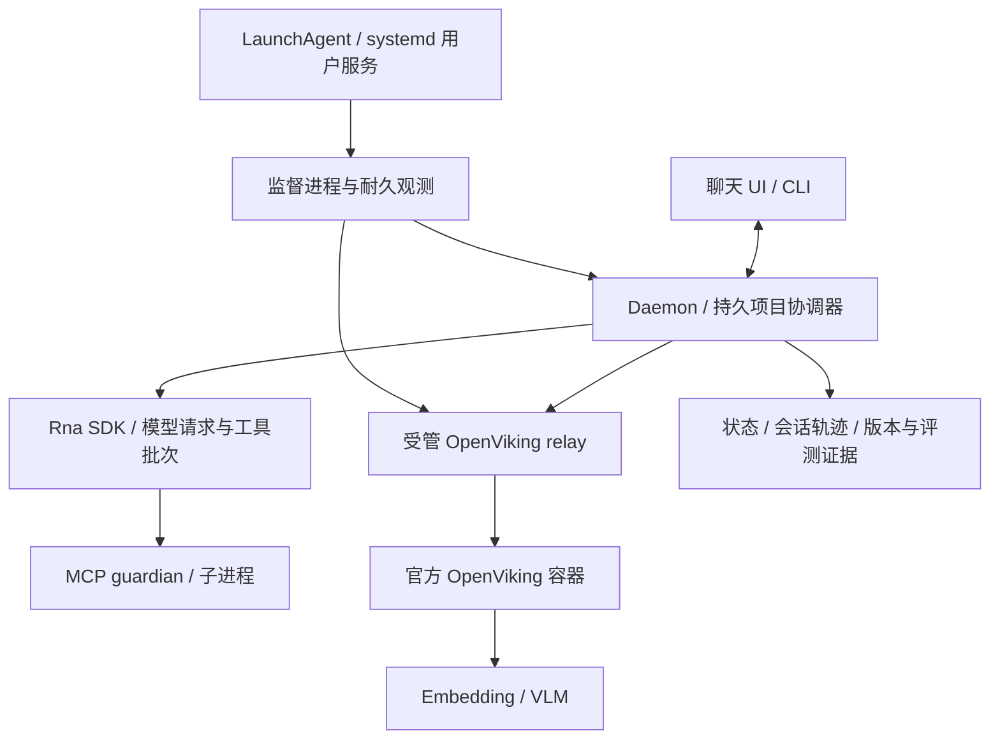

# Rna Agent 持续运行与 100+ 小时验收

本实现为控制平面 0.10.0、独立 SDK 0.4.0。目标是项目主动系统持续观察、按持久唤醒复查、执行获准工作、融入对话，以及自主生成和评估候选。没有要求先创建 Goal，也不靠重复生成无意义任务维持“活跃”。本页区分实现、故障测试、加速时间和真正的墙钟观测。

本机已于 2026-09-24 21:38（上海时间）切换为原生 LaunchAgent 托管并核对用户数据保留，见实际部署记录。新一轮 120 小时观测 ID 为 `9008806c-0936-499f-8d07-4eb0192a36b2`，首次采样 21:38:31，最早于 9 月 29 日 21:38:31 完成；当前不能宣称已通过。CLI 状态是持续变化的权威记录，本文日期和部署报告只是该次检查的快照。

## 参考代码与落实方式

Headlong 的可靠性来自多层进程管理和持久状态，不是把 agent loop 放进无限循环。[thinkers 服务定义](https://github.com/laude-institute/headlong/blob/ca0b4017f7bda7b8566c59e75a9683f635534356/deploy/headlong-thinkers%40.service) 明确采用失败重启、重启退避、启动限频、有限关闭等待，以及 deliberate_stop 防止用户停止后被重新拉起。[Web 服务定义](https://github.com/laude-institute/headlong/blob/ca0b4017f7bda7b8566c59e75a9683f635534356/deploy/headlong-web.service) 记录长时间缓存增长和内存限制的背景；进程存在不足以证明工作健康。

Rna 采用用户级原生服务管理器 → 独立 supervisor → daemon → 项目协调器／前台 session 的结构。macOS 使用 LaunchAgent，Linux 提供 systemd --user 安装；Linux 原生服务启动尚未在本机实测。MCP stdio 另有受信 guardian，宿主被强杀时回收自己拥有的进程组。Pi 的请求与工具批次边界、上下文整理，以及 Harness 的取消和资源关闭依据见请求与会话审计；Headlong 的 FIFO、wake_at、去重和恢复依据见主动调度审计。



Docker Engine 自身由主机管理，容器采用 `unless-stopped`；容器仍在运行但依赖故障时不会由该策略自动重启。Rna 的监测会报告不可用，不擅自重启 Docker Desktop 或其他容器。正常端口部署不需要 relay。

## 启动和停止

在 `prototypes/control-center` 中执行：

```sh
./rna service start
./rna service status
./rna endurance start --hours 120 --keep-awake
./rna endurance status
```

`service start` 安装并启动当前用户的服务，不需要管理员权限，关闭终端和聊天窗口不停止工作。`service restart` 应用端口或 Node 路径变化；已运行服务的 `start` 不会假装应用未生效的新配置。管理命令通过独立进程租约串行操作。`service run` 提供前台监督运行，其启动临界区也参与互斥。

macOS 原生定义使用 `ProcessType=Interactive`：此服务同时支撑桌面／CLI 的前台 HTTP 交互。根据本机 `launchd.plist(5)`，`Background` 会施加 CPU／I/O 限制，而 `Adaptive` 依赖 XPC 活动提升分类，当前 HTTP 架构不具备该条件。旧安装应在没有执行中操作时运行 `./rna service restart --native`，由原管理器退出、重新生成 plist 并重新 bootstrap；只改 plist 或 kickstart 已加载任务不会重新应用分类。部署后需核对新的 supervisor／daemon PID，以及 `launchctl print gui/$(id -u)/<服务标签>` 的实际 spawn type 为 interactive。该修改不提高实时优先级，不阻止显示器睡眠，不改变故障超时，也不能单凭配置变化宣称历史故障已全部修复或长期验收通过。

隔离原生分类对照 使用相同的 2.86 MB 合成数据，约 0.25 秒 CPU 工作在 Background 下耗时 4.17 秒、Interactive 下耗时 0.25 秒；最大定时器间隔分别为 413 毫秒和 14 毫秒。另一个临时 Background 任务成功执行 `taskpolicy -B` 后仍耗时 3.48 秒，不能用清除 Darwin background bit 代替原生分类迁移。临时任务均已移除，实验未读取用户项目或修改生产策略；它证明本机存在分类造成的调度差异，不证明过去每次重启都由此造成。

本机 Docker Desktop 兼容 relay 通过显式描述文件纳入同一 supervisor，配置及命令见 [OpenViking 部署](../openviking-local.md)。`service restart --helper-descriptor PATH` 设置受管依赖列表（可重复）；不带此参数时保留已有列表，`service restart --without-helpers` 明确清空。描述文件要求固定绝对命令、参数、工作目录和本机身份探针，不接受项目对话中任意脚本自动注册为系统服务。helper 的独立 OS 租约防止两个状态实例争用同一进程；200 响应还须符合当前 PID、随机代际身份和配置指纹。未知端口监听只报冲突，不认领、不杀死。

```sh
./rna endurance stop
./rna service stop
./rna service uninstall
```

停止写入持久意图，取消后台工作并限时关闭；不会由重启策略重新开启。卸载只移除服务定义，保留项目、会话、记忆配置、工作目录和证据。`endurance stop` 仅停止本轮观测及其防空闲休眠进程，agent 服务继续运行。

当前工作区位于 macOS 的“文稿”目录；若 Node 的系统后台访问尚未获准，原生进程可能卡在进入 JavaScript 之前。已通过隔离测试确认 LaunchAgent 本身正常；这个状态不能当作真实 daemon 已启动。运行 `./rna service start --session` 可明确选择当前登录会话的后台模式；已有原生定义时使用 `./rna service restart --session`，会先移除旧管理器。权限获准后用 `./rna service restart --native` 切回原生托管。普通 `start` 沿用已配置的托管方式。

会话模式中 supervisor 与 daemon 均独立于聊天窗口，且 daemon 故障仍会受管恢复；但 supervisor 自己退出、登出或系统重启后，不由原生管理器恢复。这是当前部署权限边界，不等于已经验证开机常驻。安装器不修改隐私设置、TCC 数据库或全磁盘权限。

权限恢复后，已使用真实 daemon 和临时项目状态完成原生启动、重复启动、重启、观测、停止与卸载共 8 项验证，包括强杀临时 supervisor 后由原生管理器自动恢复并替换旧 daemon，见原生服务报告。发现并修复了另一个独立问题：原生进程的 C locale 会让 `ps` 转义中文命令路径，造成后台与 CLI 身份不一致；现在固定 UTF-8 locale，保持原 PID／出生身份的严格匹配。该身份字符串仍包含本地时区格式，调用方使用不同 `TZ` 或运行中更改系统时区可能导致拒绝恢复，不能通过忽略身份字段来绕过。

状态文件由 `RNA_AGENT_STATE` 选择，端口由 `RNA_AGENT_PORT` 选择；同一状态文件不允许多个 daemon 并发写入。用户级服务凭据优先使用已有独立 `.secrets` 文件。提供商若只引用 shell 环境变量，需让后台服务环境能够读取该变量；安装器不把密钥复制进 plist。macOS `--keep-awake` 在观测期间启动 `caffeinate -i -s -w <supervisor PID>`，请求防止空闲睡眠及接通电源时的系统睡眠；显示器仍可睡眠，不修改全局电源策略。状态中的 `keepAwakePolicy` 说明该有限策略，不代表系统已保证不间断；停止观测或服务会释放自有断言。合盖、主动睡眠、断电、登出或网络中断仍不能保证连续工作。

## 默认期限与故障行为

| 层次 | 默认行为 |
|---|---|
| 原生管理器 | supervisor 异常退出后重启；正常停止不重启；macOS 节流 30 秒、关闭期限 30 秒 |
| supervisor | 每 5 秒探测，HTTP 期限 4 秒，启动宽限 60 秒，连续 3 次不可达后回收所属 daemon |
| daemon 重启 | 指数退避 1–60 秒；15 分钟内 5 次退出后冷却 15 分钟，避免配置错误高速重启 |
| 内存 | daemon RSS 超过 1 GiB 连续触发探测失败后受管重启；不是整机或所有第三方进程的硬限额 |
| 关闭 | 先同时取消各子系统，daemon 等待最多 15 秒，主入口 20 秒退出兜底；supervisor TERM 后 20 秒 KILL |
| 项目调度 | 最多 4 个占用项目，公平轮转；单个决策总限 120 秒，单个行动总限 30 分钟 |
| 模型协议 | 默认空闲期限 120 秒，总期限 15 分钟；明确 HTTP 429/5xx 最多重试两次；部分流和工具不重放 |
| MCP | 请求/关闭均有界；完整工具批次后的下一请求可重连失效连接；已发出的工具调用不自动重试 |
| 项目进化 | 最多 3 次自动提案／修复；脚本门槛失败不进入模型对照评测；相同失败实验持久消重 |
| 记忆依赖 | 每分钟检查服务、鉴权、初始化及 `/ready` 的文件／向量库／embedding 就绪；5 秒总限；失败降级，不回退到本地记忆，也不以重启 daemon 隐藏问题 |

健康接口包含进程身份、uptime、RSS、事件循环延迟、状态写入大小和耗时、SSE 连接数、真实用量与预留、每项目复查／隔离／退避状态。合法等待不会被当作失活。持久化、归档、调度或记忆故障会进入降级；进程还在响应时，supervisor 不通过反复重启掩盖这些错误。模型可用性来自实际请求结果，不额外发送付费“健康请求”。

HTTP 健康请求超时与执行主循环停止分别判断。daemon 通过直属 IPC 通道报告代次、递增序号、单调发送时间和是否有在途工作；不包含对话正文。supervisor 只接受当前子进程的匹配身份，同时核验发送与接收时间均在原健康超时内。若这份独立证据仍新鲜且有在途工作，HTTP 超时继续记录为不健康，但暂缓因此终止正在执行的工具。若一条健康请求跨越了工作结束，较新的空闲心跳只允许一次全新 HTTP 复查，旧失败仍然计入不健康；下一条请求仍失败就按原阈值修复，持续空闲心跳不能续期。IPC 停止、重放、积压过期、身份不符，或触发 RSS／心跳异常时，不受该暂缓保护。它不能使已停止调度的主机重新运行，也不把健康接口故障算成健康时长。

因 `HEALTH_UNREACHABLE` 实际终止时，监督日志及 `lastTermination` 保留当前代次、连续失败数、原阈值、探测开始时间，以及最后有效 IPC 的序号、工作状态、发送与接收年龄。这个有界记录不包含对话或工具正文。04:21 重启审计 确认旧日志没有终止时的 IPC 数值，故无法事后证明当时的主循环阻塞点；同一窗口多个辅助服务的延迟也不能单独归因为模型供应商或磁盘。新记录补足今后的归因证据，不改变恢复阈值。

耐久观测在受管子进程实际 `spawn` 时记录启动代次，即使它尚未提供健康 HTTP 就再次退出。首次观察的代次建立基线，后续不同代次各计一次重启，同一代次之后返回 HTTP 不重复计数。此前只按 HTTP 身份计数会漏掉从未就绪的中间进程；旧观测保留原始结果，不回填、重置或改为健康。真实子进程故障测试覆盖连续两次替换和恢复后的去重，见专项结果。

受管 embedding 返回经过当前 nonce/PID/指纹认证的 503 时，若 child 仍在且没有清理不确定性，探测快照过期、探测尚未完成，以及已确认 owner/model 后的有界冷加载，不再被当作必须杀进程的信号。状态仍为 `unhealthy`，观测照常计失败；终态加载失败、连接失联、身份异常等使用独立的连续可重启失败计数，保持原阈值。这样不会把两次“仍在加载”加一次终态错误误算成三次进程故障。

这个区分来自03:21 执行中重启审计：`project_edit` 意图先于 supervisor 的健康超时 TERM，随后形成未决工具；同一窗口出现三次 embedding 替换。修复不重放旧命令、不把未知编辑记为成功。隔离子进程测试同时验证活跃工作继续、空闲后恢复，以及停止／重放／过期／错误代次 IPC 仍触发恢复。参考 [Pi 的 abort 与等待 idle](https://github.com/earendil-works/pi/blob/a328aa89ad6e6dc5c5628ff896769532ed3d29df/packages/coding-agent/src/core/agent-session.ts#L2075) 和 [Harness 取消当前轮次并保留待办输入](https://github.com/deepseek-ai/deepseek-harness/blob/46a7f68b0922371ce7144b668b90e377d8e799f4/packages/api/session-controller/src/client/sessions/session.ts#L341)，服务重启与工具完成不是同一事件。

新 helper 启动时若 OS 出生身份查询暂不可得，不发布 `running` 所有权、不允许业务子进程启动，只回收本次直接拥有的 ChildProcess。确认该进程组已不存在后，单 helper 按原退避重试，其他 helper 与 daemon 继续运行。若组清理无法确认，则持久保留 `HELPER_START_CLEANUP_UNCERTAIN`，停止自动重建；重启也不会凭旧 PID 猜测并发送信号。存储失败仍按真正的监督故障处理。接收到已验证 nonce 的健康响应后，出生身份查询暂不可得同样只影响该 helper，不能放松其身份准入。

bf990 真实故障归因 的 247 条观察中有 228 条不健康：172 条为未决后台行动导致的执行隔离，39 条同时出现记忆或 helper 降级，17 条 daemon 不可达。系统日志确认七次接通电源时睡眠共 5,442 秒；其中一次 923 秒睡眠覆盖此前模型 `idle_timeout` 请求间隔，不能据此认定供应商停顿。两个 helper 启动身份查询失败还触发了旧代码的全局停止；本轮改为上述局部隔离。其他探针超时是否误杀了实际健康的模型，保留日志不能证明，未因此修改健康阈值或把失败记录改为健康。已有不可用、重启和观察缺口使该轮不能成为连续 100 小时通过证明。

本机 embedding 辅助服务的 HTTP 接收与就绪探测现已分离。每次只运行一个探测，从本次开始时间安排一秒后的刷新，不积累等待任务。健康响应只使用同一个仍存活 child/guardian 的完整快照：从整次探测开始以单调时钟计龄，最多有效两秒；读取不延时，失败立即替换成功，过期返回 503。这样既能让正常刷新期间继续服务，也不会把迟到结果或永久缓存当作健康。模型 tags/ps 请求各自保持一秒**总期限**，包括慢响应体；关闭取消原始 socket，有界等待，无法确认退出则保留 `cleanupUncertain`。监督器仅记录白名单状态码、布尔和有界时间值，不写出所有权 token 或响应正文。

此修复来自真实部署后的短暂退化：同步系统探测曾发生在健康请求 accept 之前。旧版在独立慢服务下复现健康请求超时，修复后通过 Python 33 项及真实托管进程集成；复现和验收、独立源码复核。它解决探测与健康接口互相阻塞的缺陷，不消除真实系统探测超时，也不保证整机调度/磁盘阻塞时所有线程仍能运行。已有不健康样本始终保留。

这里“模型可用性”指聊天／主动决策供应商。OpenViking 的 `/ready` 实现 会向 embedding 服务发送文本 `ok` 进行真实探测；默认每分钟一次，可能产生该供应商费用，不计入 Rna 聊天 token 账本。这个响应不验证 VLM 摘要／抽取和语义质量。旧服务若没有 `/ready`，会标记 `not_supported`、`ready:false`，不能拿 liveness 代替就绪验收。

服务重启恢复项目唤醒与已记录事实；未确认的前台请求和副作用保留为暂停或 `needs_review`。保证可恢复服务不等于能推断外部交易是否成功，不能为了自动续跑盲目重发工具。新的时间和外部事实不能消除错误退避。

工作区命令与能力安装命令也通过独立 guardian 执行。stdin EOF 只是输入结束，IPC 断开才表示宿主所有权消失；命令超时、取消、输出背压和后代清理都有专门的真实子进程测试。若 guardian 本身丢失或失去响应，宿主不延迟信号旧命令 PID，必须保留清理／启动不确定性。SDK 将此结果写为未决工具并停止下一次模型请求，重开会话不会清除该记录。未决安装保留 staging 与事务记录，同请求 ID 不重复安装。

后台行动若有未决外部执行，该项目暂缓新的 work／learn，仍允许等待和主动分享问题；健康接口将其标为 `executionBlocked`，不能用于全程健康验收。用户实际核对效果后，可通过 CLI 明确确认：

```sh
./rna initiative-resolve PROJECT_ID ACTION_ID --status completed --summary '已核对实际执行结果：填写具体证据'
```

只有确认操作没有执行时才使用 `--status not-executed`；已执行部分工作、确认进程结束但结果未验证时使用 `--status cancelled`，原诊断和部分结果继续保留，不改为成功。对应 HTTP 接口为 `POST /api/projects/:id/initiative/actions/:actionId/resolve`，请求体包含 `status` 和非空 `summary`。运行或尚未清理的操作会阻止确认（409 `action_still_running`）。确认保留审计，不自动取消项目暂停，也不立即制造模型请求；普通聊天中的“继续”不代表已核对未知副作用。

## 状态、日志和资源

状态保存使用完整临时文件、文件 fsync、原子 rename 和父目录 fsync。若 rename 后目录同步失败，内存对齐已可见的新值，并拒绝后续写入；不会继续在旧内存快照上操作。损坏状态不自动替换为空状态。进程排他锁使用 Node 内置 SQLite 的 OS 锁，强杀后锁自动释放；PID、随机 token 和 OS 出生身份用于识别陈旧记录。仅支持可信本地磁盘，不把它描述成跨主机分布式租约。

主动协调器的终态记录先按内容哈希归档，再裁热状态；归档失败保留原记录。未决副作用与用户对话不按此规则删除。SDK JSONL 原始轨迹保留，事件缓存可释放；上下文根据真实模型摘要增量整理。摘要请求独立预留并结算用量，失败不覆盖原轨迹。

没有可用会话时，待投递消息会在进入执行前等待，不再每秒反复进入 running／deferred 并保存完整状态。宿主以 `presence.conversationAvailable:false` 显式声明此情况；独立 SDK 调用方不传该字段时保留既有行为。状态不变的空闲 tick 不写盘；用户创建会话后可继续原投递，不自动重建或取消归档会话。模拟调度 tick 也不再为正在运行的真实模型会话保存无变化状态。

服务资料位于 `${stateFile}.service/`，私有文件模式为 `0600`：

- `config.json`、`intent.json`、`status.json`：服务定义、用户意图、当前观察状态。
- `supervisor.jsonl`、`daemon-stdout.log`、`daemon-stderr.log`：运行日志，各最多当前 2 MiB 加三份轮转。
- `endurance-request.json`：CLI 提交开始／停止请求，监督进程消费并确认；活动报告由监督进程单独写入，避免旧采样覆盖停止。停止服务也会失效尚未消费的观测请求。
- `endurance.json`：本轮权威观测汇总；下一轮开启前保留旧汇总。
- `endurance-samples.jsonl`：有界运行样本日志，适用同一轮转策略。长期累计判定来自汇总，不能只看轮转后剩余样本。

完整对话、原始模型日志、能力版本和评测证据仍随有效工作增长。当前没有把全部历史改成分页存储，完整 session snapshot 仍有线性成本。因此 120 小时低频观察与 120 小时高密度工具／MCP 负载是不同验收；不能从前者推出后者容量无限。磁盘耗尽会明确失败并保留已有状态，不自动删除证据换取“在线”。

## 怎样判定 100+ 小时

观测从首次实际采样起算，允许记录已就绪但降级的服务；这种情况从第一份样本就计为失败，不能声称该轮全程健康。每 5 秒的服务探测中，发现故障或实例变化立即记录；常态样本每分钟持久保存。超过 2.5 个样本间隔、监控重启、daemon 代次变化及墙钟／单调时钟不一致均保留为空档或异常，不补计为健康。

到达目标墙钟时长后记录 `completed`，但只有健康累计也达到目标、没有任何已观测失败、未观测空档、daemon 重启及时间异常时才 `passed:true`。自愈成功会记录为恢复，并不能抹掉中断。采样存在分辨率边界，不能证明两次探测间每个瞬间都可用。新样本包含 `runId`，共享轮转日志中的不同观测可分开核对；开始新一轮前保留旧汇总，不改写旧失败。

2026-09-24 的实际诊断观测遇到主机文件访问阻塞：18:04:08 至 20:53:54（上海时间）共 10,186.018 秒，恢复后整段计入未观测空档，没有追算健康时长。见恢复证据。这也暴露了现有架构边界：daemon 与 supervisor 都会同步访问本机存储；若二者同时卡在系统文件调用中，定时器和 HTTP 超时无法及时执行，原生管理器仅配置了异常退出重启，不能保证对未退出的阻塞进程自动恢复。独立于该存储路径的 watchdog、带提交隔离的持久化进程仍是后续工作，当前不能承诺抵抗所有主机磁盘／权限故障。

受管依赖的代次与重启计数也进入样本；即使 relay 在两次探测之间已恢复，已知重启仍计为 `managedHelperRestarts`，不计为全程无中断。外部 Docker 服务没有这个本机子进程代次契约，仍以依赖探测及其实际任务结果为证据。

报告包含实际健康秒数、不可用秒数、未知空档、最长连续健康时间、重启次数、最大 RSS、状态大小与最低磁盘余量。工作量记录实际前台／初始化／评测数及 token 账本；没有负载时的待机观测不声称完成高密度模型压力测试。

## 已执行验证

调度测试推进 **120 虚拟小时**：1,440 次外部观察、144 次供应商故障、1,296 次工作，反复恢复持久状态并检查预算、去重、唤醒和归档；固定夹具热状态最大 18,638 字节。这是时间模型与恢复语义测试，绝不是墙钟 120 小时。

真实 Node 子进程测试覆盖崩溃重启、HTTP 挂死且忽略 TERM、KILL 后恢复、主动停止、孙进程占用管道、MCP 宿主被 SIGKILL 后回收自己及后代。存储测试覆盖并发进程争锁、PID 复用、强杀释放、归档部分失败、rename 前后写入失败。上下文测试让同一意图连续调用工具 30 次，在 6K 容量中多次通过模型协议摘要，并核对工具配对和独立计费。协议回答来自确定性夹具，不证明外部模型质量。

真实旧进化候选也已回放：原来 27 次模型请求后才拒绝的脚本错误，现在在本地检查阶段拒绝，**0 次新增模型请求**；旧基线与预期未改。见进化故障审计及整体验证记录。当前实际墙钟结果请读取 `./rna endurance status`，尚在运行的记录始终显示 `passed:null`。
