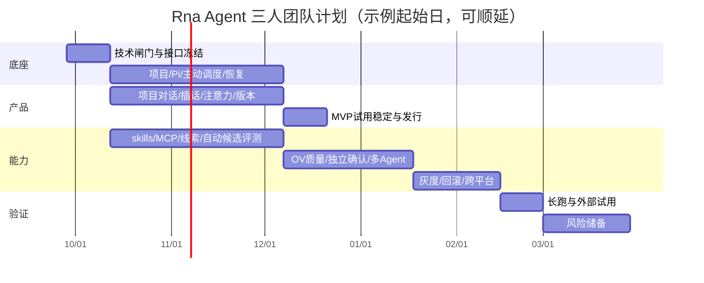

# 开发周期、资源与里程碑

日期基准：2026-09-25。使用相对周 W1 开始，避免把尚未确定的启动日期当承诺。估算覆盖正式产品，不把当前后端与界面等价为已完成的生产功能。默认每人每周5个有效工程日，另计风险储备；API费用和签名账户费用由项目选型后核算。

本轮主线调整为“项目持续理解 → 自主判断行动/沟通/安静 → 对话中随时插话 → 项目自主生成并评测版本 → 主动邀请试用”。主动性不依赖 Goal，项目管理高于会话。基础主动决策、输入注意力、项目隔离及自动候选评测进入 MVP，不能继续沿用只覆盖 Goal 调度与手动技能晋级的工期。相比原估算新增 26 基础人日（其中 MVP 新增 16），其余功能 ID 与后续研究边界保留。

估算假设：macOS+CLI 首发，先支持有限已授权事件源与 skill/工作流进化，真实模型接入、持久调度和项目版本控制均在范围内；MVP 的评测规模有限，未具备独立确认数据时必须标注实验性。通用电脑控制、平台核心自改、模型权重进化、SaaS多租户仍不进入 MVP。

## 当前实现与下一步（2026-09-28）

0.19 / 独立 SDK 0.12 已通过源码和实际安装包验收，当前权限重新核验后已在原维护操作中恢复本地部署、真实记忆及原待答问题；历史拒绝不再作为当前阻断。6E 的 0.20 / SDK 0.13 已继续部署，全局 FastCRW 搜索/抓取在真实地址验收通过，并增加停机前原生预检。新发现上游长记忆嵌入超限，未隐藏健康降级，详情见 6E 报告。原工期表用于产品范围估算，不能把历史计划、单元测试数量或一次短时运行当作能力质量已达标。独立 SDK 无 Pi SDK 运行依赖，GUI 和 CLI 共用 daemon，OpenViking 使用真实服务，不回退到本地记忆。

| 阶段 | 状态与证据 | 后续验收重点 |
|---|---|---|
| 1. 对话响应与后台协作 | 独立 responder、持久后台信箱及控制已实现 | 实际项目中的插话质量与可恢复性持续回归 |
| 2. 任务族评估 | 研究、数据、浏览器任务环境和独立确认集已实现 | 专业交付质量、候选真实收益；不能通过降低门槛提高采用率 |
| 3. JEV 与学习证据 | 0.13 / SDK 0.7 已部署：同输入校准、shadow 并行、主任务预算优先、请求中的实际改动暴露 | 12 类任务 × 3 模式实测中 active 并未普遍省 token 或提速，继续以真实回执衡量 |
| 4. 外部事件与持续协作 | 0.14 / SDK 0.8 已接通并验收：项目目录自动观察、SDK 事件收件箱、去重/积压/重启、GUI 与 CLI 来源状态与暂停 | 默认静默基线；稳定变化可进入自主判断；执行不自激；失败不制造虚假删除；暂停恢复与工作区重绑定不串证据 |
| 5. 本地发行与升级恢复 | 0.15 已部署：完整运行包核验、维护排空、原路径恢复点、兼容代码切换/回退、故障接续、GUI/CLI/安装包实测 | 在线分发、Developer ID/公证、跨平台资格仍未完成；还原不回滚外部效果 |
| 6. 实际项目质量与跨日覆盖 | 进行中：0.16 / SDK 0.9 已部署；三类 36 条真实交互、两次真实作者配对、RRSI 搜索控制与反馈、安装 GUI/CLI 验收完成 | 已发现结论越界、约束丢失与评测歧义；两候选均未达原有改进门槛。专业质量、自然技能/市场包效用、同参考对照、独立收益及跨日覆盖待验收 |

第四阶段先接项目目录这一种外部来源。消息平台、远程 CI 等新连接器仍需单独实现认证、来源权限与投递契约，不能用通用事件接口声称已经支持。目录变化只提供元数据证据，不自动创建任务、通知或进化；仍由既有项目模型、JEV 评分及自主节奏决定行动。

长期观察时长按真实覆盖自适应选择，不再将 100/120 小时写成固定条件。当前策略支持新的 2/8/26 小时分级观察窗口及显式时长；每次记录实际墙钟、空档、重启、真实工作和恢复覆盖。短窗口通过不能替代跨日工作负载证据，窗口结束也不会自动创建下一窗口或唤醒机器。具体策略见自适应观察说明。

第五阶段已完成本地运行包与持久事务契约、故障注入、真实多次升级/回退/恢复、SDK 类型与全量回归、GUI 打包与 CLI 验收，并在旧服务空闲后引导更新本地部署。验收与未完成的发行条件见0.15 阶段报告。后续先收集现有真实项目的跨日工作与交付，再补开发、研究、数据等任务的独立质量比较；不把进化采用率或测试数量当作专业能力指标。保留失败记录，不重放已执行的发布脚本，不在执行中重启。

基础资料见系统审计与阶段验收、第三阶段实测报告、参考对齐验收矩阵。下方周表仍是完整产品的历史范围估算，不是从当前日期开始的逐项承诺。

2026-09-28 首批实施与下一步已复核，见[第六阶段计划](phase6-project-quality.md)与本轮验收。6A 已运行每类 12 条真实输入；34/36 条完整收尾、35/36 条指定产物检查通过，不等于专业能力已达标。6B 先补实际截图、结论与来源/时间状态的评测、跨轮约束保持，再做新任务上的多次配对及独立确认；主动/记忆/JEV 按真实效用继续验证。6C 安装包和维护更新已验收，跨日覆盖仍待观察。已有机制不重复重做，不以采用率代替进化收益，真实观察不固定为 100/120 小时。

本轮 6B 第二批已实施：有据停止、行动反馈、真实截图/来源主张评估与多轮会话用例，及大上下文压缩/SSE性能修复。0.17.0 / SDK0.10.0 最终包已验收并部署，真实10轮指定检查和两次像素通路已通过，研究评测失败与作者归因局限保留。下一步是新独立任务上的稳定收益与确认、主动/记忆/JEV净效用，以及大状态增量传输；详情见6B报告。

本轮 6C 已部署 0.18.0 / SDK0.11.0：JEV 迟到判断失效处理、持久问题维护交接、固定重复测量、逐轮语义审阅与研究检索/任务契约修复；独立 SDK、真实安装包和 CLI 验收通过。真实候选实验未评完，尚无收益或采用率提升证明。部署遇到检查点变化与启动回执失败后，沿同一维护操作核对完成，原问题零新增模型请求接续。下一步优先处理自然技能触达/真实项目收益、压缩后的记忆使用、维护稳定性与跨日交付覆盖，见 6C 报告。

## 1. 两种交付节奏

| 团队 | 技术验证 | MVP（累计） | v1（累计） | 说明 |
|---|---|---|---|---|
| 独立开发者 | 2–3周 | 18–22周 | 58–64周 | 一人兼后端、前端、评测与发行；跨平台与真实评测不能全部并行 |
| 3人小团队 | 2周 | 10–12周 | 22–26周 | A运行时/控制，B桌面/CLI，C上下文/评测；交叉审查与共同故障演练 |

独立 MVP 以项目内主动协作与自动候选评测为必须项，默认由用户决定是否试用已通过门槛的版本；无需用户逐步启动进化流程。若只做聊天和固定 Goal 演示，可以更早产出交互样机，但不应以此宣称完成本产品的主动能力。周数假设每周5个有效工程日，业余每周3天需乘5/3。

## 2. 工作分解与人日

| 工作包 | 基础人日 | MVP人日子集 | 负责人 | 前置 |
|---|---:|---:|---|---|
| A.需求冻结、源码/许可证核查、四项spike | 10 | 10 | A+C | 无 |
| B.独立SDK、请求/缓存、持续Session/Turn | 20 | 10 | A | A |
| C.项目观察/主动决策、注意力、持久调度与恢复 | 42 | 19 | A | A+B最小链路 |
| D.skills/MCP/tool broker与权限 | 22 | 7 | C+A | B+C基础 |
| E.项目事实/开放线索、OpenViking服务/检索/删除 | 18 | 4 | C | D+存储协议 |
| F.项目自动进化、独立评测、版本试用/回滚 | 40 | 9 | C+A | C+D+证据捕获 |
| G.CLI/TUI、会话API与公共客户端 | 12 | 4 | B+A | B+C接口冻结 |
| H.项目管理/主动对话、composer、资源预览与桌面 | 31 | 11 | B | G/API契约 |
| I.观测、备份、安全与故障演练 | 16 | 4 | A+C | 全程嵌入 |
| J.跨平台发行、文档、试用反馈 | 25 | 3 | B+全员 | 基本闭环 |
| **合计** | **236** | **81** | | |
| 风险储备（基础的25%） | **59** | **20.25** | | 原生依赖、provider差异、恢复漏洞、签名/平台差异 |
| **含储备** | **295** | **101.25** | | |

MVP 子集81人日包含在236人日中，不额外相加。含储备约101工程日，独立 MVP 18–22周覆盖最小值与集成浮动；完整 v1 295工程日约59周，安排58–64周。三人不能直接除3：真实试用、数据积累、接口冻结和故障演练构成关键路径，MVP10–12周、v1 22–26周。

## 3. 3人团队排期

| 周期 | A：运行时与控制 | B：产品与发行 | C：上下文与评测 | 退出条件 |
|---|---|---|---|---|
| W1–2 | Pi源码研究/自有缓存spike；Project/Session/Run/Observation契约 | 项目选择器、主动对话草图、CLI/桌面壳PoC | 状态与开放线索规范；OpenViking部署/许可与评测隔离PoC | G0：四个spike有实证；明确无Goal主动运行和版本边界 |
| W3–4 | project registry、journal、queue/steer、观察去重 | 项目内会话、常驻composer、主动消息类型、CLI attach | skills/MCP最小连接、项目episode规范 | G1：同项目多轮真实执行，无Goal事件触发一次有证据的主动沟通 |
| W5–6 | 主动决策/静默出口、前后台优先、typing/presence时效 | 插话、通知延迟、草稿/资源、项目切换 | 开放线索/OpenViking隔离检索、能力缺口与自动campaign | G2：输入中不抢话，插话先处理；跨项目不串记忆/消息/预算 |
| W7–8 | 预算/lease/恢复、后台执行与版本绑定 | 版本邀请、证据diff、试用/回滚入口 | 自主候选构建/自动开发评测，失败留痕 | G3：后台发现→候选→评测→主动邀请闭环，不需逐步点击 |
| W9–10 | 缓存对照、崩溃/断线/副作用核对 | macOS内测包、长会话/无障碍/窄屏 | 20个真实项目任务、误报/打扰率/样本偏差 | G4：试用仅影响新run；坏候选拒绝；回滚及隔离验收通过 |
| W11–12 | 修复试用阻塞、观测 | 上手、更新、MVP发行 | 数据拆分/盲评/污染测试 | MVP发布，主动协作与自动候选评测为必需项 |
| W13–14 | 更多事件源/长期Goal、父子预算 | 项目观察/开放线索详情与子会话谱系 | OV抽取与检索评测、删除链、独立确认集 | G5：长期Goal可选叠加，独立评测证据可核查 |
| W15–16 | 多Agent/隔离工作树、release controller | 版本历史、灰度可见性、Linux/Windows适配 | 选择/确认gate、任务族回归 | G6：正式晋级通道通过污染/故障测试 |
| W17–18 | 自动灰度回退、长跑/恢复/性能 | 跨平台安装/升级、备份迁移 | 成本收益归因、主动有用率与回归扩容 | G7：按真实工作与恢复覆盖验收跨日持续协作；时长自适应，主动噪声与预算有界 |
| W19–22 | API冻结、P0/P1与外部试用修复 | 文档、签名发行、跨平台UI | 数据质量、真实收益与不确定性报告 | v1候选，独立验收 |
| W23–26 | 跨模块风险储备、发布稳定 | 同左 | 同左 | 未用储备不扩需求 |

甘特图以日历天示意并行阶段；详细交付以周表和人日为准，9月28日仅为示例起点。

## 4. 独立开发者执行顺序

| 累计周 | 重点 | 可以先省略的范围 |
|---|---|---|
| W1–3 | 固定Pi、缓存/恢复spike、OpenViking部署、项目契约、CLI真实任务 | 完整主题、插件市场 |
| W4–7 | 项目观察/OpenViking隔离、无Goal主动决策、queue/steer、预算 | 多Agent并行、广泛事件连接器 |
| W8–11 | 项目桌面对话、输入注意力、产物与资源、skills/MCP | 浏览器/电脑控制、复杂资源分屏 |
| W12–15 | 项目自动候选/对比评测、主动版本邀请、试用/回滚 | OV复杂训练、平台核心自改 |
| W16–22 | 崩溃/隔离测试、真实试用、macOS发行与缓冲 | Windows、远程协作 |
| W23–32 | 更多事件源、OV抽取质量、删除一致性、独立确认评测 | 模型权重训练 |
| W33–44 | 自动灰度回退、工作流/工具演进、多Agent | 自由架构搜索 |
| W45–56 | 跨平台、升级备份、持续主动可靠性与真实任务扩容 | SaaS多租户 |
| W57–64 | 风险储备、发布稳定 | 无新增范围 |

## 5. 第一批可直接开工的任务

| 顺序 | 任务 | 估算 | 完成定义 |
|---|---|---:|---|
| T01 | 锁定Pi版本和独立 Rna 单 session SDK demo | 1人日 | 流式结果、工具、日志、usage可读 |
| T02 | 原生 Pi 与独立 Rna 请求比较 | 2人日 | 固定任务和provider，记录差异/缓存/预热 |
| T03 | Project/Session/Run/Observation及input/event schema | 1人日 | 项目与执行关联、主动触发、queue/steer、注意力及版本冲突有契约与薄链路测试 |
| T04 | 工具intent与响应丢失恢复 | 2人日 | mock外部写只执行一次，unknown_effect明确 |
| T05 | CLI/UI同项目对话与无Goal主动最小链路 | 1人日 | 同会话主动消息→用户插话→steer/stop一致；仅薄UI验证，不含完整模型决策与桌面体验 |
| T06 | evaluator隔离与候选hash | 1人日 | 候选访问隐藏目录被拒绝，修改后旧分数失效 |
| T07 | OpenViking接口/许可证/必需服务部署spike | 1人日 | 连接真实OV完成项目读写/隔离；离线显式报错且无本地回退，许可决策记录 |
| T08 | 评估闸门与范围冻结 | 1人日 | 明确继续/降级/替代，每项有实测证据 |

T03/T05 是接口与薄链路验证，完整composer、资源预览和恢复交互由 H 包与 W3–8 完成，不把其工作量隐藏在一日spike中。会话迭代按以下次序验收：先打通持续Session和流式Turn，再实现执行中queue/steer与停止，再接无Goal主动观察/消息与typing延迟，随后打通自动候选评测/版本邀请，最后验证跨项目隔离、试用回滚、历史阅读、窄屏和资源渐进披露。对照 [会话交互专项验收](feature-matrix.md#会话交互专项验收)；界面应先达到可连续协作，再扩充管理页面。

## 6. 成本估算方法

开发成本=实际人日×团队全成本；不要在没有地区/薪资信息时给伪精确金额。模型月成本预算可按下面透明假设估算，不是供应商报价：

`交互成本 = 成功任务数 × 每任务尝试次数 × 每尝试模型费用`

`总成本 = 交互 + 主动探索 + 预热 + embedding/rerank + 候选生成 + 所有评测 + 远端计算/存储`

示例仅为预算规划：每日20任务、每任务总模型费$0.20，30天为$120；主动/进化各配$30、预热/检索$20，则计划月预算$200。真实价格、缓存与成功率必须由 Rna 的供应商用量回执及账单校准。当前 v0.9 已实现共享 token 预留、报量结算与缺报估算；价格配置和费用对账尚未完成，不承诺货币硬上限。真实 token 上限默认不限制，用户可另行配置；上述示例金额不会写入实际配置。

## 7. 风险与应对

| 风险 | 预警 | 应对/止损 |
|---|---|---|
| Pi快速演进破坏接口 | SDK变更、缓存快照漂移 | 固定版本，维护薄adapter；升级独立迭代 |
| 包了Pi后缓存收益下降 | 单成功任务费用明显上升 | 排查prompt/schema/压缩；先不启用动态工具注入 |
| 预热估计与账单不符 | 实际输出/读写token高于估算 | 关闭默认预热或校准阈值；不牺牲正确性 |
| 自主循环过量消耗 | 无成果run、频繁自唤醒 | 无价值线索退避、有限反思预算、消息去重/冷却、TTL |
| 外部写重复执行 | 崩溃后重试无idempotency | unknown_effect与人工核对，不以吞异常掩盖 |
| 自进化只提升自测 | 保留集不升/旧任务下降 | 拒绝晋级、改善数据与目标操作化 |
| OpenViking许可/部署复杂 | 分发方式无法满足需求 | 独立部署并明确许可路线；前置连接/隔离闸门，离线明确降级为无记忆可用，绝不回退本地 |
| 桌面跨平台成本超标 | 原生依赖/签名/进程树差异 | macOS先发，分平台闸门 |
| 主动能力退化为Goal脚本/打扰通知 | 不建Goal就沉默、固定步骤重放、输入中抢话 | 用无Goal事件、静默出口、插话重评和注意力验收阻断；主表面保留自然对话 |
| 项目版本/记忆越界 | A的邀请/候选出现在B，切版本影响在途run | 所有对象强制projectId与manifest；隔离与版本固定做P0验收 |
| 范围增长 | 新增能力无验收/负责人 | 新需求换出同规模工作或调整日期 |

## 8. 发布完成标准

对应发布阶段的需求清单P0全部通过；缓存与成功率报告可重跑；崩溃/权限/预算/回滚测试有记录；安装包在干净机器验证；真实任务试用的问题已分级且无开放P0。项目无Goal也能基于真实状态发起有价值交流，输入中尊重注意力、插话优先；进化自动生成/评测候选，在证据支持时主动通知试用，并能拒绝/回滚坏版本。项目数据与版本隔离通过。用户能从任一入口继续同一Session，在运行中区分steer和follow-up，停止/恢复执行、查看工具过程和产物；资源按需打开，管理页不取代对话，刷新不丢失或重复已确认输入。文档准确区分支持、实验和计划功能。没有正向自进化收益时可发布“实验性进化工具”，但不能宣称系统已验证持续变强。
