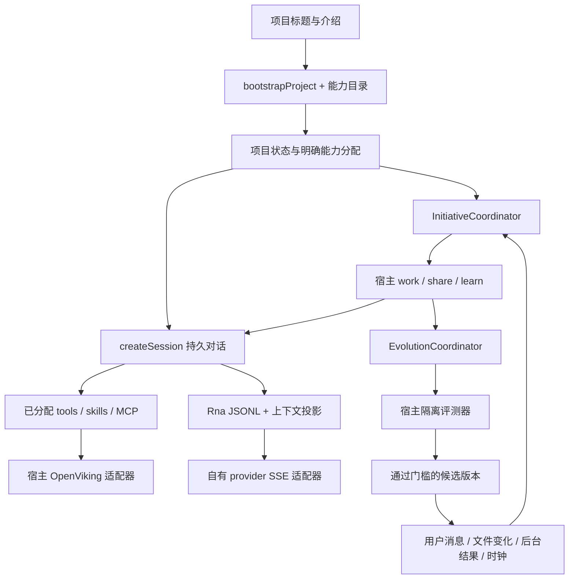

# Rna Agent SDK 0.8：实现、宿主契约与边界

本文描述 `packages/sdk` 的实际实现，取代早期设计中“直接依赖 Pi SDK”的运行路线。旧研究文档中的 Pi SDK 集成建议属于历史方案。当前基础包为独立 ESM JavaScript 实现，没有 Pi SDK 导入和第三方运行时依赖；原型的 HTTP 服务、CLI 和桌面投影通过宿主适配层使用它。

最小真实模型调用见 [SDK README](../packages/sdk/README.md)。包尚未发布到 npm，Node.js 最低版本为 22.19.0。`0.3` 的含义是可运行、可测试的第一版内核，不表示已经完成所有供应商兼容、分布式执行或生产安全审计。

## 0.8 项目外部事件

新增来源绑定的持久事件收件箱与类型契约；宿主将目录变化接到已有主动判断，而不直接发送消息或执行任务。保存、投递、运行时接收、归档分别有回执，文件变化不表示完成。详细接口见项目事件 SDK，发行与边界见第四阶段发布记录。原有对话、学习、JEV 校准与评估合同继续适用；下文按实现阶段保留说明。

## 技能资产与评估执行契约（2026-09-26）

项目作者可以用 `{id, inheritFromBaseline:true}` 继承原技能；修改技能时，可在 `resources` 中用 `{path, inheritFromBaseline:true}` 保留资源。主机只从冻结基线展开，正式 `ProjectGenome` 始终是完整内容，没有引用占位。原技能和资源不能因省略而丢失；提案外层 `withdrawSkills` / `withdrawSkillResources` 需包含精确 `beforeHash` 和具体原因。`proposal.assetChanges` 记录继承/删除来源，脚本修复不改变这些资产。`evaluateProjectGenomes` 的可选 `assetDeclarations` 只声明这两类删除，不能修改测试；缺失或失配在付费比较前拒绝。宿主重评还对照原私有提案，保持声明与原候选一致。

`PROJECT_EVALUATION_RUNTIME` 包含固定执行 profile 与 session policy。当前 `workflow-v3` 对未声明 `suite.execution` 的任务默认 16 步、每请求最多 4096 输出 token；显式套件配置优先，实际模型输出容量进一步限制。每次比较保留只读 `evaluationExecution`（profile 身份、原套件哈希、各任务有效额度、策略、完整清单哈希），双方配置相同。评估不会自动压缩、接续或增加总结请求，未完成仍无分数。模型会获知环境和额度，不能把技能中提到的浏览器或文件工具当成已注册能力。模型参数也在调用入口复制，防止回调或调用者中途修改配对条件。旧 runtime 的结果不迁移或补写；重新评估是新实验，旧用例及门槛保持。

`workflow-v2` 的 `schema-recovery-v1` 区分可纠正的调用参数与执行失败：只有 SDK 在派发前生成 `neverExecuted` 校验收据、同一工具与目标在后续成功纠正，且其他原有效参数未改，才认可恢复。原错误、后续调用及恢复关联全部保留；运行时错误、权限拒绝和结果未知不据文字自动恢复。配置解析器保留旧 profile 的 `strict-v1` 身份；新执行使用当前 profile。旧分数不回填，新比较会带新 runtime/profile 身份，门槛和冻结用例均不改写。

`workflow-v3` 的 `schema-recovery-v2` 在此之上再认可一种恢复：`project_write` 不带 `expectedHash` 覆盖本对话没观察过（`not_observed`）或观察后已变化（`conflict`）的文件时被拒、什么也没写，之后读取该文件并对同一路径成功 `project_write` 或 `project_edit`。收据只来自评估器包在宿主工作区写工具外的记录（`writeGuardReceipt`），不取工具文字或 details。`workflow-v2` 的结果是在没有这道写入保护时得到的，与 `workflow-v3` 不可比较。

产物检查新增 `javascript_function`，验证无 import 的同步纯 ESM 导出在给定 JSON 输入下的输出。验收进程不携带凭据，开启 Node 权限限制并限制时间、输出和堆；预期值留在宿主，传入子进程的只有源码、导出名和参数。它不是完整浏览器或任意第三方代码的安全沙箱，不支持 DOM、网络、异步函数，也不证明视觉质量。`coverage.behaviorChecks` 和执行声明区分这种有限行为验证与仅语法检查。确定性回答检查使用保留的完整最终回答；裁判的有界预览带截断标记及原文哈希，不推断省略内容。

`executeProjectEvaluationCase({genome,caseId,model,...})` 可独立运行冻结套件中的一个任务，返回工具、产物、计量与执行清单。它复用正式评测执行器，但不打盲评分、不准许晋升（`promotionEligible:false`），适合开发和真实接入验收。六类任务与失败场景见场景矩阵。

这不是前台 Session 的步数策略。交互长任务仍使用分片接续，不能把有限评估的 16 步理解为产品自主运行上限。完整声明约束在 [SDK 源码](../packages/sdk/src/project-proposal-inheritance.mjs)和[评估 profile](../packages/sdk/src/project-evaluation-profile.mjs)中；实际结果见验收记录。

## 1. 系统边界



SDK 不创建一个必须先设定的 Goal。项目本身提供持续上下文，外部事件和工作结果提供新的证据；模型决定是否值得行动。调度器只允许宿主已注册的动作，决定做什么不等于获得新权限。时钟、事件监听、对话投递和真实评测都由宿主接入。

## 2. 上游借鉴与实际取舍

下表固定到本工作区研究提交。这里的“借鉴”指重新实现相应契约和机制，不表示整段上游实现已移植，也不将不同项目的能力简单相加。

| 来源 | 固定代码位置 | Rna 的实现与取舍 |
|---|---|---|
| Pi `a328aa89ad6e6dc5c5628ff896769532ed3d29df` | [agent-loop.ts](https://github.com/earendil-works/pi/blob/a328aa89ad6e6dc5c5628ff896769532ed3d29df/packages/agent/src/agent-loop.ts)、[agent.ts](https://github.com/earendil-works/pi/blob/a328aa89ad6e6dc5c5628ff896769532ed3d29df/packages/agent/src/agent.ts) | 模型与工具循环、steer/follow-up 两种队列、安全边界投递；Rna 用自己的持久 journal 和副作用状态机实现 |
| Pi 同一提交 | [anthropic-messages.ts](https://github.com/earendil-works/pi/blob/a328aa89ad6e6dc5c5628ff896769532ed3d29df/packages/ai/src/api/anthropic-messages.ts)、[openai-completions.ts](https://github.com/earendil-works/pi/blob/a328aa89ad6e6dc5c5628ff896769532ed3d29df/packages/ai/src/api/openai-completions.ts) | 稳定 system/tool/history 边界、会话缓存身份、usage 拆分；当前只实现两个协议族的明确子集 |
| Pi 同一提交 | [cache-warmer.ts](https://github.com/earendil-works/pi/blob/a328aa89ad6e6dc5c5628ff896769532ed3d29df/packages/coding-agent/src/core/cache-warmer.ts) | 研究经济型预热策略；Rna 当前 `cacheWarming: off`，没有移植预热、TTL 预测和完整定价 |
| DeepSeek Harness `46a7f68b0922371ce7144b668b90e377d8e799f4` | [agent.ts](https://github.com/deepseek-ai/deepseek-harness/blob/46a7f68b0922371ce7144b668b90e377d8e799f4/packages/core/agent-loop/src/agent.ts)、[inbox.ts](https://github.com/deepseek-ai/deepseek-harness/blob/46a7f68b0922371ce7144b668b90e377d8e799f4/packages/core/agent-loop/src/inbox.ts)、[session chain](https://github.com/deepseek-ai/deepseek-harness/blob/46a7f68b0922371ce7144b668b90e377d8e799f4/packages/session/session-format/src/chain.ts) | 区分待接收输入、已执行轨迹和 UI 投影；Rna 保留 request/assistant/tool 身份、队列操作和完整性链，不复制其全部资源、子会话或 ACP 栈 |
| Headlong `ca0b4017f7bda7b8566c59e75a9683f635534356` | [monolith/step](https://github.com/laude-institute/headlong/blob/ca0b4017f7bda7b8566c59e75a9683f635534356/thinkers/monolith/step)、[monolith/prompt.md](https://github.com/laude-institute/headlong/blob/ca0b4017f7bda7b8566c59e75a9683f635534356/thinkers/monolith/prompt.md)、[responder/step](https://github.com/laude-institute/headlong/blob/ca0b4017f7bda7b8566c59e75a9683f635534356/thinkers/responder/step) | 无命令时仍可观察、选择工作／分享／学习／等待；Rna 用事件证据、持久动作状态、预算与沟通礼让约束重新实现，不执行上游 Bash dispatcher |

ASPIRE 的证据积累、候选变化和验证闭环用于指导进化边界，论文核验情况及不能外推的结论见论文笔记。当前实现不涉及模型权重训练，也没有通过实验复现论文效果。

## 3. Provider、事件和缓存

本轮新增的计量与投影契约详见记忆同步、上下文投影与消息来源。`Usage.cacheUsageReported` 区分真实零命中和未报告；命中率分母仅为 `input + cacheRead + cacheWrite`。`SessionSnapshot.contextUsage` 与 `context_usage` 事件提供当前输入估算、真实容量、输出预留、自动压缩状态及压缩前后读数，和累计 token 账单独立。事件在稳定请求、工具与压缩边界更新，不按文本 delta 重算全历史。

`streamCompletion({ model, apiKey, systemPrompt, messages, tools, cache, signal, timeoutMs, fetch })` 是 async generator。低层事件为 `text_delta`、`thinking_delta`、`thinking_signature`、`toolcall_start`、`toolcall_delta`、`tool_call`、`usage`、`done`。`tool_call` 只有参数 JSON 完整后才发布；`toolcall_start { index, id?, name }` / `toolcall_delta { index, id?, name?, argumentsDelta }` 只用于显示参数流（OpenAI 兼容 `tool_calls[].function.arguments` 分片、Anthropic `input_json_delta`、Codex `function_call_arguments.delta`）：名字到达后才发 start（此前的参数随后补发），迟到或分片的名字以完整名字出现在后续 delta 的 `name` 中，并行调用按 `index` 区分；不流式参数的供应商不产生新事件，最终组装与校验不变。会话把它们作为 `message_update`（`transient: true`，`assistantMessageEvent.type` 为 `toolcall_start`/`toolcall_delta`，含 `messageId`）交给 `onEvent`，**不写入会话日志**，`seq` 沿用最近一条持久记录；HTTP 重定向拒绝，错误体不原样回显。SSE 支持跨 chunk UTF-8、CRLF、分片工具参数和流提前结束检测。

请求超时采用同一个 `resolveCompletionTimeoutPolicy()`：默认传输空闲上限 `idleTimeoutMs=120000`、请求绝对上限 `totalTimeoutMs=900000`。收到字节（包括 reasoning 或 SSE 心跳）只刷新空闲计时，不延长总时限。`CompletionRequest.timeoutMs` 保留旧的空闲别名；`iterateCompletion(..., {timeoutMs})` 保留显式总限覆盖，并把实际总限传给底层。自定义 provider 仍由外层总限与取消保护；传输字节空闲检测由 `streamCompletion` 执行，不能把尚未消费的用量当成已收到的账单。

学习反思和主动决策默认遵守同一 120 秒空闲/900 秒总限，活跃推理不再被独立的 120 秒总限提前砍断。`reflectProjectLearning` 的旧显式 `timeoutMs` 仍是总限，新 `totalTimeoutMs` 优先，亦可设置 `idleTimeoutMs`；主动决策的显式 `policy.decisionTimeoutMs` 保持总限。学习请求回执、主动决策结果/失败诊断和持久 lastDecision 保存只有数值及来源枚举的 `timeoutPolicy`，不包含正文或凭据。超时不新增自动请求或重试次数，预算准入和 abort 仍然生效。

`model` 必须给出 `providerId`、`modelId`、`protocol`、`baseUrl`、`contextWindow`、`maxOutputTokens`。`reasoning`、`cacheRetention` 与 `compat` 可选。图像请求还要求 `input` 明确包含 `image`，未知能力不会猜测支持。SDK 不负责供应商模型目录下载、凭据 UI 或自动核实模型规格；这些属于宿主配置服务。

| 协议 | 当前处理 | 明确限制 |
|---|---|---|
| OpenAI 兼容 Chat Completions | 文本／reasoning、工具调用、stream usage；有界内联图片；DeepSeek 官方地址的 thinking/effort 参数 | 不是 Responses API；不自动覆盖所有兼容供应商特例；无音频、视频输入 |
| Anthropic Messages | 文本、内联 image、thinking 与签名、tool_use/tool_result 内图片、缓存块、usage | 需模型支持图像及所选 thinking 模式；未覆盖音频、视频、URL 图片与供应商实验特性 |

图片采用 `{type:'image',data:<base64>,mimeType}`；用户使用 `session.prompt(text,{images})`，已授权工具和 MCP 使用相同块。PNG/JPEG/GIF/WebP 单图 8 MiB，请求最多 16 张且总计 16 MiB；Messages 单图另外不超过 5 MiB。OpenAI 工具图片在完整结果批次之后以带调用来源的图片消息传输，不新增真实用户授权。模型不支持时明确说明像素未读取，不静默丢图或重放已完成工具。详见图像链路与视觉验证边界。

`createSession` 公开更高层的 `agent_start`、`turn_start`、`message_start/update/end`、`tool_execution_start/update/end`、inbox 变化、`agent_end`、`agent_settled` 等事件。每条事件带 journal `seq`；它单调增长但可能有间隔，因为内部事实也占日志序号。观察者异常不应导致工具重复执行。

**撤销（C4）。** 宿主收回某段上下文的来源（删除对话、撤回投递、隐私范围变化）时，该上下文在对话里的副本要立即折叠，不等下一次冷断点。`beforeRequest` 钩子可返回 `revokeContext: [{ id?, contextKeys?, sourceIds?, before? }]`（至多 16 项）：键为 `contextKeys` 的、时间不晚于 `before`（毫秒）的副本，以及 `contextSources` 含 `sourceIds` 之一的副本（`contextUpdates` 里每条更新可带 `sourceIds`，至多 16 个不透明字符串，存在消息的 `contextSources` 上，不进入模型可见的文字）——不论作用域、也不论后面是否有新副本——折叠成一行，写 `context_fold` 记录 `{ reason: 'revoked', targets: [{ messageId, contextKey, kind: 'revoked' }] }`。在只追加的目标（Anthropic）上它不等思考下限，附带一次 `thinking_rebase`（reason `revoked`）。日志保留副本原文，重放得到同样的投影；同一项重复发送不产生新记录。折叠之后同一个键的新副本照常追加（被撤销折叠的最新副本不算“可见”）。闲时预备好的摘要（`compaction_prepared`）若归档了被折叠的副本，会被丢弃（`compaction_prepared_discarded`，code `revoked`），免得提交时把被撤销的内容带回投影。钩子处理完后发一个不入日志的瞬时事件 `context_revoke { ids, folded, summaries, withdrawn }`：宿主据此不再重复发送，`folded > 0` 或 `withdrawn` 非空时不再 ping 这段对话的缓存保活；`summaries` 是已提交、且归档过含被撤销 `sourceIds` 的副本的压缩记录 id（它们的摘要可能转述了被撤销的来源；记录的来源列表被截断时无法排除，也算），`withdrawn` 是其中正在生效的那一条。`context_compaction` 记录带 `sourceIds`（它归档的那些副本的 `contextSources` 并集，上限 512，超出记 `sourceIdsTruncated`；与上一次压缩的记录合并），以后撤销时可以知道哪些摘要可能转述了被撤销的来源。摘要是模型自己写的文字，改不成“只去掉那一件事”，所以生效中的那条被撤回：用一条新的压缩记录（同一个边界，`trigger: 'revoked'`，`withdrew` 写被它取代的记录 id，`sourceIds: []`）把摘要换成固定的说明（`SUMMARY_WITHDRAWN_TEXT`：早先的摘要已撤回，不要依赖，需要之前的内容就问用户）。它是一条普通的压缩记录：照常写日志、重放、在只追加的目标上随一次 `thinking_rebase`（reason `compaction`），旧版本读到也只当作一次压缩。代价是被摘要掉的早先对话在模型眼里没了（消息原文和被撤回的摘要留在日志里），直到下一次压缩；之后的压缩从这条说明起算，不再把被撤回的摘要文字喂给新摘要，也不会再扫描已折叠的副本。没有来源列表的压缩记录（早于这一版写下的）无从判断，不撤回。只有按 `sourceIds` 撤销才会撤回摘要（隐私范围变化、被撤回的投递）；按键撤销（如其他对话被删除后的笔记块）折叠的是对话状态块，这些块的旧副本本来就不进摘要的输入（被取代的副本和压缩后原样恢复的最新副本都被略去）。**回滚。** 退回 0.68.0 或更早时：这些版本不认 reason 为 `revoked` 的 `thinking_rebase`（重放时忽略），并把 `kind: 'revoked'` 的折叠读成 `superseded`；在只追加的 Claude 目标上，只追加的下限之后的折叠本来就不生效，所以被撤销的副本回滚之后可能重新进入模型请求（日志里的记录不丢，升级回来又会折叠；这些副本的撤销条目 `project.mind.revocations` 也还在，对话下次请求时会再次要求折叠）。撤回摘要的那条记录读起来就是一条普通压缩，摘要说明照常投影。

缓存实施范围：

1. 工具按名称稳定排序，参数 schema 按键规范化；固定系统提示和能力集合形成 `prefixHash`，动态证据进入消息尾部。
2. `sessionKey` 由项目和会话身份稳定生成，重开会话保持一致。前缀 hash 是诊断身份，不能当作供应商命中结果。
3. Anthropic 的系统、工具末尾和消息边界使用受支持的 `cache_control`；`retention: long` 请求 `1h`。OpenAI 官方地址或显式兼容配置使用 `prompt_cache_key`，长保留仅在兼容标志开启时请求。DeepSeek 自动缓存依赖服务端返回，不发送无依据的 OpenAI 缓存字段。
4. `usage` 将未缓存 input、output、cacheRead、cacheWrite 分开保存；供应商没有回报时不能推断命中。金额当前 `unpriced`。
5. `estimatedInputTokens` 使用文本 UTF-8 bytes/3 加每图 8192 tokens 准入余量，并参考已报告模型用量；图片 base64 不当作普通文本也不计为零。只用于容量规划，不是精确 tokenizer、所有模型的严格上界或账单。

结构化任务使用协议级输出约束与本地校验。低层 `CompletionRequest` 可显式声明 `responseFormat:{type:'json_object'}` 与 `toolChoice:'none'`；不受支持的显式请求在网络调用前失败。`resolveJsonOutputContract(model)` 依据经核验的官方端点/模型或 `compat.supportsJsonObject`、`compat.supportsToolChoiceNone` 声明选择原生约束；未知兼容服务、未核验模型或 Anthropic 不猜测接受 OpenAI 参数。高层结构化任务会记录 `native` 或 `prompt_only`，这是请求约束方式，不能当作 schema 或能力评估已通过的证据。显式 `false` 覆盖推断；没有请求失败后额外付费降级。当前核验范围与原始资料见协议审计。

候选作者和初始化在五轮只读研究后保留一次无工具输出，`stepLimitInstructions` 保持各自 JSON schema，`stepLimitResponseFormat:'json_object'` 为尾轮协商上述输出方式。隔离作者禁用自动压缩，普通会话仍按自身策略运行。后台复盘与主动决策复用同一协议适配，所有业务 schema、权限、来源及评估检查继续独立执行；完整混合文本或内部工具标记不能冒充有效 JSON。

隔离作者另用已有 `beforeFinish` 检查研究阶段的提前结束：整段 JSON 对象可以完成，叙述或混合文本收到有来源的主机格式反馈，在原五步内继续；第六次尾轮不追加反馈。该检查不验证业务质量、不从叙述中提取 JSON、不增加请求上限，也不改变普通对话。`author_format_feedback` / `bootstrap_format_feedback` 只记录消息身份与反馈次数，不形成新的项目经验证据。

`SessionError.responseDiagnostic?: CompletedFinalResponseDiagnostic` 只记录 SDK 已完整收到的无工具尾轮空正文或截断：含请求/消息 ID、SDK 停止原因、输出字节数和对应类别，并写入 `request_completed`。普通 Session 仍以 `step_limit` 失败，不自动重试。隔离结构化作者另行核对该收据与实际尾消息，才交给各自原有的有限输出修复流程；未知、取消、预算及工具越界错误不具备这个资格。提供商抛出的同名属性不会被透传为可信收据。旧适配器曾将未知供应商终止原因归一为 `stop`；未保留原始原因的历史记录不能据此证明供应商正常结束，具体修正及新协议验收见验证记录。

内置流适配器按各协议的明确终止值映射 `stopReason`，另在完成事件、会话记录和错误中保留受长度及字符限制的 `providerFinishReason`。异常、冲突、未知或缺失终止原因不会生成成功完成事件，也不发布待执行的工具调用；它们不能进入作者的格式修复重试。已交付的累计用量仍须计费：同一请求更新累计值，不逐帧加总；不同请求才相加。取消前未交付给消费者的网络数据不等同已取得计费回执，缺失用量仍按现有未知用量规则处理。这项修正不会回填旧日志缺失的供应商原始原因。

隔离作者另有条件式产物提交通道。只有当前操作实际完成原生 JSON 尾轮、没有工具调用、原始终止值为 `stop` 且正文全为空白，才在操作内保留已完成研究的上下文。剩余尝试可用一个 `submit_project_artifact` 调用传输草稿，不重复研究，也不增加模型确认轮次。资格通过内部对象身份关联，历史错误文字或提供商自带诊断不能触发。学习候选、参考作者与初始化各自保留原尝试上限和独立 schema；脚本修复与裁判路径不切换。

提交工具只在专用收集器中声明，不注册到项目工具表，也不执行参数中的代码。收集器消费完整响应并等待计费结束后，再检查取消、终态、调用数量及完整 schema；接纳仅表示获得内存中的未验证草稿。持久提案、来源复核、工具继承、自检、冻结对照评估和发布仍由原宿主流程完成。请求不附加 `response_format`、强制 `tool_choice` 或 beta strict，不改变端点和思考设置，因此不能承诺模型一定调用。操作内研究快照不能跨进程恢复；中断仍走原有证据核对。设计及验证范围见结构化产物提交，本机部署和真实结果以验收记录为准。

提交参数的语法失败另有严格限定的修复入口：真实适配器必须收到 OpenAI `[DONE]` 和正常 `tool_calls`，确认唯一、正确命名、身份和分块无歧义的提交调用，仅其完整参数发生 JSON 语法错误。内部证明绑定本次请求、schema、上下文和提交契约；收集器在计费结束且未取消后一次性消费。无效参数仅在当前操作内作为下一次未验证修复数据，不写通用错误、公开轨迹或持久产物；审计只记录固定分类、身份、字节数与哈希。模型仍须重新提交通过严格 JSON 和 schema 校验的对象，没有部分 JSON 容错接受。缺结束标记、异常终态、多工具、错误身份、参数超限及结算失败均不产生这一资格。普通 Session 的工具错误处理不变。

此修复使用各作者原有的尝试余额，不新增专属次数：项目候选的三次尝试在上述路径中最多六次研究/尾轮请求加两次单提交，即八次作者请求；初始化原有四次额度可为九次。评估请求另计，费用仍逐请求准入。历史错误若没有这份私有完成证明，不能事后根据 `tool_calls` 或错误文字补发资格。

进化提案的作者专用协议允许以 `{id, inheritFromBaseline:true}` 明确保留已发布工具。SDK 从本次冻结基线展开完整实现与自检，记录 `toolInheritance` 来源哈希；它不是运行时工具类型。已发布 genome 仍只有完整定义，空工具数组不触发自动继承。继承项在本次脚本修复中不可修改，自检内容也不会反馈给作者；新建或明确修改的工具仍须通过自检及冻结兼容检查。详见继承边界。

真实自动摘要压缩已实现，图片历史在摘要请求中保留 MIME/字节数/hash 句柄和明确未提供像素的说明，原图留在日志。尚未实现：Pi 全供应商适配矩阵、CacheWarmer 的经济门槛、跨设备缓存迁移、跨供应商 KV 复用、稳定延迟／成本基准。不能据此宣称缓存已经优于或完全等同于 Pi。

## 4. 持久会话与中断

`createSession({ sessionId, projectId, cwd, stateDir, sessionFile?, model, apiKey?, tools?, customTools?, systemPrompt?, onEvent?, provider?, redactValues?, maxSteps?, maxToolOutputBytes? })` 返回会话句柄。主要方法：

| 方法 | 行为 |
|---|---|
| `prompt(text)` | 闲置时开始并等待本次循环收束；忙碌时明确报错 |
| `steer(text)` | 持久排入当前上下文的下一安全边界；返回队列条目 |
| `followUp(text)` | 当前工作收束后接续 |
| `observe(text, {wake})` | 外部证据进入持久 inbox；`wake:false` 只排队 |
| `withdraw(id)` / `clearQueue()` | 只移除尚未接收的内容 |
| `abort()` / `resume({toolResolutions})` | 请求取消；遇到不确定副作用时先由宿主确认结果 |
| `compact({summary?, summarize?, keepLastTurns?, instructions?})` | 闲置且工具已解决时压缩完整旧轮次，原始记录仍保留 |
| `snapshot()` / `dispose()` | 读取投影／关闭并释放单写者锁 |

SDK 自有 JSONL 格式包含 header、消息、request、tool intent/result、队列、压缩和事件。消息、请求、工具意图／检查点／结果等执行记录在 publish 前 fsync；流式 UI 事件使用最多 64 KiB／128 行的写入缓冲，不逐 token fsync，下一条执行记录或正常关闭会按顺序同步此前事件。崩溃可能丢失尚未同步的显示尾部，它不能授权工具执行或证明请求完成。所有行仍带 seq/prevHash/hash；文件 `0600`、目录 `0700`。写入或 fsync 失败后该句柄拒绝继续追加，必须关闭并重新校验日志。损坏的已提交行会拒绝加载；进程中断留下的未完成末行单独保存为 torn 文件后恢复。哈希链是意外损坏检测，不是防本机管理员篡改的签名系统。与 Pi／Harness 的具体比较及故障测试见流式日志持久性。

工具执行先写 intent，再执行，最后写 result。恢复时已完成工具不重跑；不确定的非幂等写工具进入明确的待确认状态。`resume()` 的 key 使用 `snapshot().recovery.uncertainTools[].callKey`，不只用 provider call ID，避免跨消息重名。

默认 `maxSteps=64`，工具输出上限 1 MiB。模型输出不完整时不会根据半截工具参数执行。取消向模型请求和工具 `AbortSignal` 传播；它不证明远端写入被撤销，工具实现必须遵守 signal、幂等键和实际权限。

## 5. Skills、tools 与 MCP

`CapabilityRegistry` 是应用能力授权目录；`createSession` 的原始工具参数是宿主可信注入入口。所有来自插件、模型分配或可编辑配置的工具，都应先经过 registry，不能绕过它直接拼入会话。

技能必须显式 `enabled:true, trusted:true`，使用明确 `SKILL.md` 路径。SDK 静态读取内容、有限提取 name/description、计算 SHA-256，不执行 Markdown shell 代码，不自动安装依赖，不假定 skill 文本能授予权限。宿主只把已分配技能的名称、用途和 hash 写入可追溯目录；模型经 skill_load 按需读取正文与包内相对资源。技能正文不常驻 system prompt，未分配技能不能加载。

工具必须声明 `permission: read|write|exec`、JSON schema 和 `execute(callId, args, signal, onUpdate)`。registry 在调用前校验参数，支持有限且明确的 schema 关键字和本地 `$ref`，不支持的关键字拒绝注册。`idempotent:true` 只能由了解实际副作用的宿主声明，不能只相信 MCP 服务器的自述 annotations。

内置 `project_read` 和 `project_list` 限定真实工作区路径、拒绝父目录逃逸和私密路径，并限制文件大小与输出。它们是**应用层读取范围检查，不是 OS 沙箱**；对抗与读操作并发的恶意文件系统修改、第三方 MCP 进程或任意写／执行工具，需要宿主另加进程／容器隔离。

以下完整例子从仓库根目录运行，不调用付费模型，使用随 SDK 提供的实际 stdio 测试进程验证协议：

```js
import { resolve } from 'node:path';
import { CapabilityRegistry } from './packages/sdk/src/index.mjs';

const registry = new CapabilityRegistry({ mcpServers: [{
  id: 'example', transport: 'stdio', command: process.execPath,
  args: [resolve('packages/sdk/test/fixtures/mcp-server.mjs')],
  enabled: true, trusted: true,
  allowTools: { echo: { permission: 'read', idempotent: true } },
}] });
try {
  await registry.connectMcp('example');
  const { tools } = await registry.resolve({
    skillIds: [], toolIds: ['mcp:example:echo'], mcpServerIds: ['example'],
  });
  const result = await tools[0].execute('example-call', { text: 'Rna MCP protocol check' });
  console.log(result.content[0].text);
} finally { await registry.close(); }
```

服务还公布了另一个未授权写工具，但不会进入 registry。真实 MCP 配置同理：先连接并发现，再由显式 allowTools 筛选；授予 server 不能自动授予其全部工具。HTTP 凭据建议用 `headerEnv: {Authorization: 'YOUR_MCP_AUTH_ENV'}`，变量内容由宿主管理。stdio 不使用 shell 拼接，默认只继承 PATH/HOME/TMPDIR 和显式 env；这不等于对子进程实施沙箱。

当前 MCP 支持 initialize、initialized、分页 tools/list、tools/call、取消通知、超时、HTTP session header 与 DELETE 结束，以及单个 POST 响应内的 JSON/SSE。没有完整 OAuth discovery、resources/prompts 管理、服务器发起 sampling/elicitation、独立 GET 通知流或旧式 HTTP+SSE 传输。

## 6. 项目初始状态

`bootstrapProject({title, description, catalog, model, apiKey, provider?, completion?, signal?, onEvent?, maxAttempts?})` 调用模型产生：overview、focus、facts、openQuestions、milestones、assignments、unmetCapabilities。输出经过 schema 和能力目录双重校验。每个分配须有唯一理由，MCP tool 必须同时分配其 server；无真实模型返回 `blocked/configured_model_required`。

初始化不给模型主机 tools，但要求生成独立项目能力包；宿主在临时目录实际执行生成脚本 smoke 后才发布，并校验所选目录能力。SDK 默认有界重试，宿主允许最多四次生成/修复；schema、权限与实际脚本检查失败会反馈诊断，API 失败不能伪装成初始化完成。facts 的证据源仍是模型对标题和介绍的解释，不能当作完成了仓库实测。未知信息进入 openQuestions，里程碑从 pending 开始。

原型 `ProjectInitializer` 将 queued 项目交给此接口，持久化 model selection、用量、能力 hashes 和初始化状态，并向项目主会话加入初始说明。项目标题／介绍／工作区在请求期间变化会使旧结果失效。已有版本的项目不能通过初始化重试覆盖版本历史。

## 7. 无 Goal 的主动决策

公开类名为 `InitiativeCoordinator`，即项目的主动决策协调器。`observe` 提供证据，`tick` 在新证据或 nextReviewAt 到期时调用模型，`idle` 等待已启动工作。SDK 不偷偷创建无限定时器；宿主决定事件来源、定时间隔和生命周期。

以下可复制示例只配置主动分享处理器，模型能决定 wait 或 share；真实分享仅写控制台，未绑定外部消息平台：

```js
import { mkdir, readFile, rename, writeFile } from 'node:fs/promises';
import { resolve } from 'node:path';
import { InitiativeCoordinator } from './packages/sdk/src/index.mjs';

// model、apiKey 取自宿主已配置的真实模型，与 README 的 model 结构一致。
const model = JSON.parse(process.env.RNA_MODEL_JSON);
const apiKey = process.env.RNA_MODEL_API_KEY;
const directory = resolve('.rna-initiative');
await mkdir(directory, { recursive: true, mode: 0o700 });
const file = resolve(directory, 'state.json');
let state;
try { state = JSON.parse(await readFile(file, 'utf8')); }
catch (error) { if (error.code !== 'ENOENT') throw error; }
const coordinator = new InitiativeCoordinator({
  project: { id: 'example-project', title: '迁移助手', description: '验证迁移的失败恢复行为' },
  model, apiKey, state,
  policy: { notificationMuted: false, cooldownMs: 300000, tokenBudget: 30000 },
  saveState: async value => {
    const temporary = `${file}.tmp`;
    await writeFile(temporary, JSON.stringify(value), { mode: 0o600 });
    await rename(temporary, file);
  },
  handlers: {
    share: async action => {
      console.log('Rna Agent 主动消息：', action.content);
      return { summary: '已在宿主控制台显示主动消息', usage: { totalTokens: 0 } };
    },
  },
});
try {
  await coordinator.observe({
    id: 'project-introduction-v1', type: 'project_opened',
    summary: '项目介绍明确提到失败恢复，目前还没有恢复测试用例。',
  });
  await coordinator.tick({ presence: { typing: false, activeTurn: false } });
  await coordinator.idle();
} finally { await coordinator.close(); }
```

这不是先制定 Goal 再线性执行：事件已经足够触发模型对项目状态的判断。重复相同 event ID 会去重。生产宿主需要更严格的事务持久化和消息幂等投递；上例的单进程文件写入和控制台输出只是接入示范。

允许动作来自已提供的 handlers；模型不能新增 handler。`work`／`learn` 收到 `{signal, project, actionId, idempotencyKey, evidence, tokenBudget}`，并返回摘要与实际 usage。动作先记录为 running 再执行，完成结果成为新证据。新证据使正在推理的旧决定失效，避免用户纠正后继续执行过期选择。

notificationMuted、typing、activeTurn 和 cooldown 只约束分享，不阻塞可运行的后台工作。每次决策和工作先作 token 预算保留，得到实测用量后对账；未知用量采用保守计入。真正的工具成本、供应商计费和不服从 signal 的宿主执行器仍由宿主控制，不能把这个账本称为物理硬限额。

进程重启时 running 动作变为 `needs_review`，不会假设效果未发生再执行。宿主通过 `resolveAction(id, {status:'completed'|'not-executed'|'cancelled', summary})` 确认结果，核对说明必须非空，运行或未清理操作结束前拒绝确认。`cancelled` 表示已核对并终止但结果未验证，保留原诊断与部分结果，不能声称成功或从未执行。单个项目协调器不能代替多进程租约、数据库事务和全平台预算服务。

## 8. 项目级自主进化

`EvolutionCoordinator` 提供可执行的候选生成与对照评测流程；真实的项目执行环境和评分器由宿主提供。默认候选由已配置模型产生，也可注入 `propose` 便于受控实验。候选只能修改 strategy 和已经分配的 skill instructions，不扩展 tools/MCP/权限，不改模型权重，不覆盖活动 SDK 文件。

宿主接入示意，所有方法和参数均为当前实现签名；`evaluate` 是应用必须实现的真实评测函数：

```js
import { EvolutionCoordinator } from './packages/sdk/src/index.mjs';

export function createProjectEvolution({ project, model, apiKey, baseline,
  cases, evaluatorId, evaluate, state, saveState, onEvent }) {
  return new EvolutionCoordinator({
    project, model, apiKey, baseline, cases, evaluatorId, evaluate,
    state, saveState, onEvent,
    policy: { tokenBudget: 50000, minCases: 3, minImprovement: 0.01 },
  });
}

// baseline = {versionId, strategy, skills:[{id,instructions}],
//             assignments:{skillIds,toolIds,mcpServerIds}}
// cases = [{id, input, expected, weight?}, ...]，由宿主冻结；不要交给候选模型修改。
// evaluate({project, version, testCase, side, signal, tokenBudget})
//   => {score:0..1, passed:boolean, safetyPassed:boolean, evidence:{...}, usage?}
// await evolution.runCycle({evidence:[真实项目事件], signal});
// await evolution.trial(candidate.id);    // 宿主接受试用后调用
// await evolution.promote(candidate.id);  // 宿主接受升级后调用
// await evolution.rollback();            // 结束试用或回到此前活动版本
```

需要更细的调度时可分别调用 `proposeCandidate({evidence, signal})` 和 `evaluateCandidate(candidateId, {signal})`。`currentVersion({includeTrial:false})` 默认返回活动版本。`snapshot()` / `saveState` 支持恢复，`close()` 请求终止并等待当前操作。

评估冻结 baseline、candidate artifact、case、evidence 的 hash 和 evaluatorId，在相同 case 上交替执行两种版本。默认至少 3 个 case，加权平均提升必须严格大于 0.01，每个 case 不回退，candidate 的 acceptance 和 safety 均通过。有完整 usage 时检查 token 比率不超过 1.25；缺失 usage 明确不算已完成费用验证。通过后生成 `evolution_candidate_ready` 事件，**不自动激活版本**。

宿主将 ready 事件交给 `InitiativeCoordinator.observe`，由主动决策决定何时向当前对话提示“新版本可试用”；用户接受或宿主已有明确更新策略后再调用 trial/promote。这样主动进化融入项目对话，而不是在聊天外建一套必须手动点运行的演示卡。

这个通用协调器的保证范围为 `configured_cases_only`，统计声明为 `none`：三道用例通过不是普遍更聪明，也不是显著性检验。使用此底层 API 的宿主须提供真实任务评测器和隔离环境。Rna 0.3 的项目后台使用下节的 `proposeProjectGenome` / `evaluateProjectGenomes` 完整链路，在临时工作区运行基线和候选；`awaiting-evaluation` 仅作为旧候选的历史状态保留，不能借用演示分数宣称可更新。

## 9. SDK 与产品接入矩阵

| 能力 | SDK 状态 | 当前控制平面／CLI 接入 |
|---|---|---|
| 真实 provider、流式会话、工具循环 | 已实现 | `rna-runtime.mjs` → `runtime-controller.mjs`，聊天与 CLI 使用同一内核 |
| 持久队列、steer、followUp、停止恢复 | 已实现 | 通过现有 daemon API、CLI 和会话投影接入 |
| 手动／自动 compact | 已实现真实摘要、完整工具批次边界及计费 | UI／CLI 共用宿主命令，使用实际模型摘要并记录用量；自动压缩按上下文容量触发，原始journal保留 |
| skills、工具范围、MCP | 已实现 | CapabilityInstaller + CapabilityInstallService，聊天 capability_*、真实 UI 和 CLI；项目分配在步骤边界更新，技能按需加载 |
| 模型生成项目初始状态 | 已实现 | ProjectInitializer 接创建项目与重试状态；等待真实模型配置时阻塞 |
| OpenViking | 通过宿主 tools 接入 | 唯一记忆后端；官方 Docker REST 测试另见部署文档 |
| 无 Goal 主动决策协调器 | 已实现独立 SDK API | ProjectInitiativeController 持续循环已启用；旧演示项目保留独立 demo-policy |
| 候选生成／同集对照／试用／晋升／回滚 | 已实现独立 SDK API 与项目宿主链路 | 真实后台运行冻结标准下的基线/候选评测，门槛通过才可试用；轮次固定能力版本，旧演示评分不能用于真实候选 |
| 按来源安装能力 | 已实现常见子集 | 本地/Git技能、npm/stdio/HTTP MCP、命令工具；不等于任意包生态全兼容 |
| 自动部署新 SDK、训练权重 | 未实现 | 不作为当前版本完成项 |

模块目录：providers、session、journal、context、capabilities、mcp、workspace-tools、bootstrap、initiative、evolution。公共导出集中在 `packages/sdk/src/index.mjs`；私有 journal 的底层写入接口不作为稳定公共 API。CLI 是控制平面的客户端，基础包没有第二份独立 CLI 状态。

## 10. 验证与下一步

SDK 测试覆盖协议分片、缓存参数、usage、工具校验、持久恢复、双写者锁、中断工具结果、两类队列、MCP 实际子进程和 HTTP 协议、初始化能力拒绝、证据过期、分享礼让、预算与候选门槛。测试中的模型协议夹具只验证代码契约；真实模型 smoke 与官方 OpenViking Docker 检查单独记录，最新数量见验证记录。

隔离 evaluator、版本试用和共享 token 预留已在 0.3 接入，见下节。后续重点是文件/CI 观察源、更多供应商兼容、缓存基准、系统隔离、跨主机租约与费用对账。每一层都需要独立验收，避免把 SDK 接口存在等同于桌面已具有完整自主能力。


## 11. 0.2 的运行边界

`beforeRequest` 在上一批工具落定后等待宿主准备新能力，应用按配置和项目授权 revision 重建 registry，再关闭旧 MCP 连接。目录变更持久去重；取消准备不发模型请求。`afterRun` 是可等待的收束回调。回调不是面向不可信来源的扩展执行器；其代码属于宿主。

`beforeTool` / `afterTool` 是会话级工具钩子：调用的 `tool_execution_start` 先发出（与 pi 相同），然后前者在参数校验之后、`tool_intent` 之前运行，可以拒绝（`refusalReceipt`，从未执行）；被中止时调用保持“从未派发”，不是 uncertain，也不为它记录结束事件或完成。后者在工具返回之后，只能追加文本和 details。应用的 ToolPolicy（`prototypes/control-center/tool-policy.mjs`）用它们给前台、后台和子代理装同一套前置门（约束门，以及本轮检查点或工作树同步的等待）和写后检查（守卫、代码诊断，共用写前基线）。基线在那次等待落定之后读取，不跨运行保留（检查结果还取决于别的文件）；只有必须自己读文件的检查在写入前运行，各自受自己的时限约束（守卫脚本的、诊断热检查的）；TypeScript 语言服务把写前文本带进写后那一次检查，在内存里一并检查，写入不等它。没能取得基线的检查不把任何发现算作新的，写后第一次的结果作为本次运行之后写入的基线（mu：宁可漏，不可把老问题说成新问题）。详见 [SDK README](../packages/sdk/README.md)。

逐工具钩子看不到经 `project_exec` 写的文件（shell heredoc、脚本）、worker 合并带来的文件和生成工具写的文件。宿主因此在运行将要结束时按净改动再检查一遍守卫（`ToolPolicy#sweep`，`beforeFinish` 的宿主回调里，不是 SDK 新接口）：前台回合在 `finishTurn` 里，先于 `turn.settled` 和会话工作树应用到项目文件夹；后台在自己工作树里的运行在 `finishGitRun` 里，先于 B 合并到项目文件夹。改动的路径由代码从仓库算出（直接模式：回合检查点的进度，只取 `attributable()` 给它的路径，即不含别的所有者这段时间里经宿主应用写入的路径；用户在编辑器里同时改的文件没有记录、分不出来，与回合回退说明的是同一个限制；会话或后台工作树：当前文件对它的基线），每个文件在本次运行开始时的状态作为基线，所以文件本来就有的命中只计数：守卫在运行开始时的整个文件夹里重跑一遍（`materialize`，每次通道只写一次，用完即删），读别的文件的守卫（规则文件、章节列表）也得到正确的基线；取不到基线的命中只计数、不交给模型，并在报告里点名（写后钩子对没有基线的检查是同一条规则）。本次运行已有写后钩子检查过的 (守卫, 路径, 文本)（含子代理在自己根里检查过、再合并进来的文件）不再检查。文件并行检查（上限 4，总时限 30 秒），守卫脚本和 JEV 分诊与写后检查相同。新命中让运行续写一次（`host-guard-pass` 反馈）；这一次用掉没有，从会话日志里读（有没有本方的 `finish-feedback`），不在提出时记标志：被用户新输入盖掉、SDK 丢弃的反馈不占用它。续写用掉后，发现留在回合行 `turn.guardPass`（后台留在改动集行 `guard` 和它的对话行）并在时间线说明。项目没有监视写入的守卫、或本轮没有用过命令、生成或 MCP 这类能无钩子写文件的工具时整个通道跳过。没有仓库、没有检查点、或在项目文件夹里直接工作的后台运行没有变更来源，不检查。守卫读不了的文件（读被拒：超过读取上限 1,048,576 字节、被拒绝）不是命中：生成的检查按契约把它放在结果的 `unchecked: [{ path, reason }]` 里（`guardResult` 规范化，至多 20 条、各字段 200 字符），写后报告单列一行 `Could not check: <title> — <path> (<reason>). This is not a finding about the file; do not change the file for it.`（那一次写没有命中时它是报告里仅有的一行，没有续写）；扫尾只在有命中要报时把同样的行放在命中之后，没有命中时扫尾不出文本，只在 `outcome.unchecked` 里留痕。它不计入 `fix`、不触发那一次续写、不进 `turn.guardPass.open` 和改动集的 `guard.open`，基因上累计 `unchecked`（没能看全的运行次数，一次运行不论几个文件只记一次），一个检查的“安静运行”要扣掉它们，所以一直读不了的检查不会被当成“从没发现过问题”而被提议停用。

更新技能目录不会改变固定系统提示。工具声明变更仍会重新计算 prefixHash，不会为了保缓存向模型保留过期 schema。尚未实现 Pi 的增量工具 transcript / provider 原生补丁协议，缓存预热仍关闭。

前台能力安装服务使用 staging、版本固定、连接/工具 schema 校验和一次持久化发布；安装失败回滚并返回可修复工具错误。已发出的外部写入若结果不明仍进入 uncertain，不谎称回滚。完整可复制样例见[安装说明](capability-installation.md)，真实调用链见[端到端测试](../prototypes/control-center/test/capability-conversation.test.mjs)。

项目后台默认只使用已授予的只读工具。当前版本允许用户明确配置 `background: 'inherit'`，使后台受同一项目权限上限及工具分配约束；不会自动获得前台能力安装管理工具。事件/时钟触发判断，不生成合成事实。详见Headlong 接入。

## 12. 0.3 项目能力版本

项目初始化现在生成完整 ProjectGenome，而非只选择通用技能。可执行脚本、不可变文件、冻结评估标准、真实基线/候选 SDK 运行、盲评证据与晋升门槛已接入宿主主动循环。手工编辑与自主 learn 共用评测服务和并发锁。系统提示词/技能/工具随版本真实生效，轮次开始后固定版本，暂停恢复也不混入新能力包。详情见[完整契约](specs/project-genome-lifecycle.md)与源码研究。

真实预算改为 nullable 独立账本，旧 demo 用量不阻断真实请求。InitiativePolicy 和后台 handler 的 tokenBudget 可以为 null，表示无应用内硬限。模型容量来自明确目录而非预算猜测，见配置来源。


0.4 持续运行的实现、加速验证和实际观测严格区分，见[持续运行说明](operations/continuous-runtime.md)、主动调度、请求与会话、进化故障。本机 daemon 已有 OS 排他写锁；它不等于 SDK 宿主天然具备跨主机事务。

### 工作区文件搜索与新建文件

`project_grep` 的 `path` 可为普通文件或目录；仍是字面值查询，遵守同一 UTF-8、单文件大小、4 MiB 扫描量和 100 条匹配限制。新支持的显式文件路径不跟随符号链接，私密目录与越界路径仍拒绝；目录遍历和 `project_find` 的既有语义不变。普通运行与隔离评估使用同一个实现。

新建文件优先调用 `project_write({path, content, createOnly:true})`，并省略 `expectedHash`。它使用原子 create-if-absent 提交：同名文件已存在时（即便内容相同）明确冲突，不能覆盖。`createOnly:true` 与任何 `expectedHash` 同时出现均拒绝；`false` 或省略保持原写入行为，旧 JSON `null`/SHA-256 哈希继续兼容，字符串 `"null"` 继续严格拒绝。`project_edit` 不增加此选项。

创建模式进入工具回执与持久 checkpoint；中断后的 reconciliation 只观察当前文件，不重放创建，不从“当前内容相同”推断历史创建成功。该接口减少新建意图的 nullable 参数歧义，不代表模型调用错误必然消失，也不修改历史评估结果或门槛。
