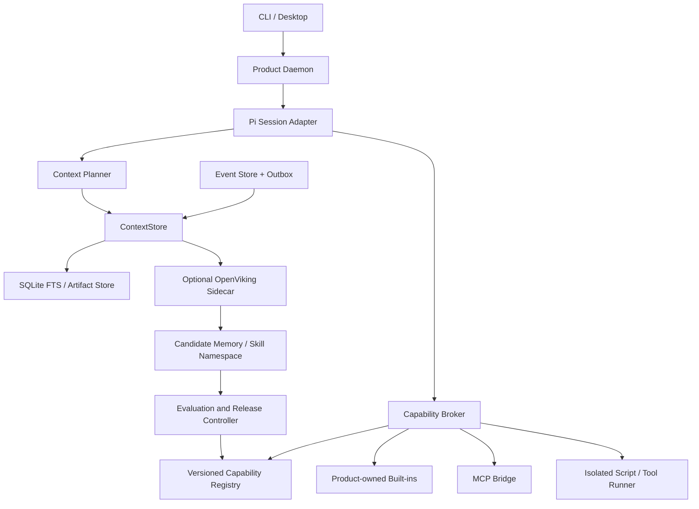
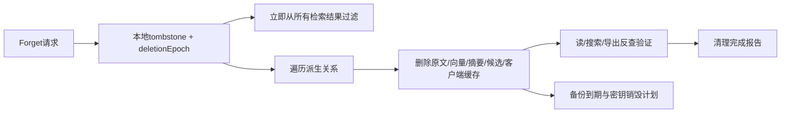

# 上下文、记忆与能力接入规格

状态：Rna Agent 的目标规格，尚未实现。上游事实以 OpenViking 源码审计 和 Pi 源码审计 为准。本文 API、表结构、manifest 与阈值是产品设计；不应误认成 Pi/OpenViking 的现成接口。

阶段边界：MVP交付本地ContextStore、来源记录、基本删除/屏蔽、skill版本与人工试用晋级、MCP工具调用和统一broker；OpenViking先做技术验证，其完整接入、派生清理、MCP资源/提示模板、独立确认与自动灰度属于v1。下文描述最终契约，不把全套规格计作MVP已实现。

## 1. 不变量与模块边界

1. Pi 是 MVP 唯一在线 compaction owner；OpenViking 是可选 sidecar，不决定目标状态、权限、预算和生产发布。
2. ContextStore 可替换，核心任务无需 embedding 或 OpenViking 服务也能开始。
3. 运行使用固定的 `contextEpoch`、`capabilitySnapshotHash`、`releaseManifestHash`；后台更新在下一个明确边界生效。
4. 技能正文、MCP 描述、工具结果、网页与记忆均不能直接授予权限。权限来自用户授权、工作区策略与最终 broker 校验。
5. 同一 task 的每次副作用有独立 actionId、证据和恢复状态；模型重试不等同安全重做。
6. 进化对象是记忆、skills、workflow、检索参数与经审查的适配器；MVP 固定模型权重。可信 policy/budget/credential/evaluator/release 控制面不可自修改。



## 2. ContextStore 领域模型

### 2.1 数据类型

```ts
type ContextKind = 'fact' | 'preference' | 'episode' | 'resource'
  | 'experience' | 'skill' | 'hypothesis';
type TrustLabel = 'user_asserted' | 'verified_tool' | 'external' | 'model_derived';
type MemoryStatus = 'candidate' | 'active' | 'conflicted' | 'stale'
  | 'quarantined' | 'revoked';

interface ContextScope {
  tenantId: string;
  principalId: string;
  workspaceId: string;
  allowedNamespaces: readonly string[];
  // 凭据不在此结构中；服务端按scope解析短期句柄。
}
interface SourceRef {
  eventId?: string;
  artifactHash?: string;
  uri?: string;
  version?: string;
  startOffset?: number;
  endOffset?: number;
  trust: TrustLabel;
}
interface MemoryRecord {
  id: string;
  scope: ContextScope;
  kind: ContextKind;
  revision: number;
  contentHash: string;
  bodyArtifactHash: string;
  status: MemoryStatus;
  sources: SourceRef[];
  createdAt: string;
  validFrom?: string;
  validUntil?: string;
  lastVerifiedAt?: string;
  conflictGroupId?: string;
  supersedes?: string;
  sensitivity: 'public' | 'workspace' | 'private' | 'secret';
  allowedUses: ('recall' | 'summarize' | 'learn' | 'export')[];
  producerVersion: string;
  deletionEpoch: number;
}
interface ContextEntry {
  recordId: string;
  uri: string;
  revision: string;
  tier: 0 | 1 | 2;
  text: string;
  contentHash: string;
  tokenEstimate: number;
  rankSignals: Record<string, number | string>;
  sources: SourceRef[];
}
interface ContextEnvelope {
  envelopeId: string;
  contextEpoch: string;
  entries: ContextEntry[];
  tokenEstimate: number;
  projectionWatermark: number;
  deletionEpoch: number;
  degraded: boolean;
  degradationReason?: 'offline' | 'timeout' | 'index_lag' | 'unsupported';
}
```

“置信度”不以模型随口给出的 0.98 作为真值概率。记录证据类型、独立来源数量、检查结果与时效；如果提供数值 ranking signal，UI 明确说明它是排序信号。`secret` 默认不进入 embedding、长期记忆和候选生成；按任务临时使用的凭据通过 broker 注入，不进入会话正文。

### 2.2 服务接口

```ts
interface ContextStore {
  capabilities(): Promise<{
    backend: 'builtin' | 'openviking';
    hierarchical: boolean;
    extraction: boolean;
    snapshots: boolean;
    scopedSearch: boolean;
  }>;
  retrieve(scope: ContextScope, request: {
    query: string;
    kinds: ContextKind[];
    maxTokens: number;
    maxEntries: number;
    excludeIds: string[];
    contextEpoch: string;
    minimumWatermark?: number;
    signal: AbortSignal;
  }): Promise<ContextEnvelope>;
  read(scope: ContextScope, id: string, revision?: string): Promise<MemoryRecord>;
  project(scope: ContextScope, batch: {
    batchId: string;
    fromSeq: number;
    throughSeq: number;
    sourceHash: string;
    events: readonly unknown[];
  }): Promise<{ acceptedThroughSeq: number; jobId?: string }>;
  propose(scope: ContextScope, candidate: {
    parentId?: string;
    expectedRevision?: number;
    record: Omit<MemoryRecord, 'status'>;
  }): Promise<{ candidateId: string }>;
  forget(scope: ContextScope, request: {
    operationId: string;
    recordIds: string[];
    sourceRefs: SourceRef[];
  }): Promise<{ deletionEpoch: number; jobId: string }>;
  inspectJob(scope: ContextScope, jobId: string): Promise<{
    status: 'queued' | 'running' | 'completed' | 'failed' | 'reconcile_required';
    stages: Record<string, 'pending' | 'done' | 'failed'>;
  }>;
}
```

Adapter 不把上游任意 metadata 直接升级为 `active` 状态。`propose` 只产生候选，正式 promotion 走控制服务；低风险事实的自动入库策略仍由 [自进化规格](evolution-and-evaluation.md) 的 E1 门禁决定。

### 2.3 最小持久表

| 表 | 关键字段 | 约束 |
|---|---|---|
| `context_records` | id/scope/kind/revision/status/hash/source_set | scope+id+revision 唯一；正文存内容寻址 artifact |
| `context_edges` | from/to/type/source_version | derives_from、supports、contradicts、supersedes |
| `context_outbox` | batch_id/scope/from_seq/through_seq/hash/state | batch_id 唯一，同一scope有序投影 |
| `context_projection` | backend/scope/ack_seq/indexed_seq/backend_session | ack 与 indexed 分开 |
| `context_envelopes` | run/turn/epoch/item_revision/hash/deletion_epoch | 同一次请求重试复用 envelope |
| `deletion_ledger` | op_id/scope/source_ids/epoch/state | tombstone 不随普通版本回退删除 |
| `context_jobs` | type/backend_task_id/stage/error/retry_at | 超时可查询，不静默吞错 |

不假定 SQLite 事务能同时提交 Pi JSONL、OpenViking HTTP 和外部文件；通过记录意图、outbox、校验 hash、恢复对账实现跨边界一致性。

## 3. Context Planner 与缓存预算

每轮先按用户最新输入决定是否 recall：续写同一工具步骤、工具运输消息、没有新信息的心跳不默认再检索。任务切换、引用未见材料、上下文缺证据或明确请求记忆时触发查询；模型可使用受控 retrieval tool 补充取回。

预算必须满足：

```text
system + frozen_tool_schemas + skill_catalog
+ selected_history + retrieved_context + current_input
+ output_reserve + safety_margin <= provider_context_limit
```

token 值按实际模型 tokenizer 或保守估计器计量，不能简单把中文字符固定除以4。预算不足时先降低检索层级/条目数、工具结果只留可追溯摘要，然后调用 Pi 原生 compaction；Pi 返回的压缩事件开启新 epoch。省略的上下文可追溯到原文 URI，不把“省略”伪装成不存在。

首轮规划参数：recall soft deadline 1–2 秒、单轮 memory 注入 2k–4k tokens、L2 单条上限与总上限并用；这些均为待实测默认值，工作区可调低。高精度任务允许显式升级检索预算，但从同一 run ledger 预留费用。

系统 prompt 和工具定义保持版本化稳定，recall 在尾部追加 `ContextEnvelope`。固定序列化、排序与 source hash；不得在重试时把同一条历史消息原地重写。缓存策略需与 [Pi 集成规格](pi-integration-and-cache.md) 的 provider 能力开关配合，稳定 schema 也不能保证供应商命中。

## 4. OpenViking 适配映射

以下按审计 commit `de1c5c49541f8910877db31f1a4ceb617e8e9855` 的 TS SDK/HTTP 路径核对：

| 产品动作 | 已有 SDK / HTTP | Adapter 必须补充 |
|---|---|---|
| 按预算 recall | `searchContext(query, options)` → `POST /api/v1/search/search`，`mode: "context"` | scope、过滤候选/tombstone、超时、版本与质量标记；**不是 `/search/context`** |
| 原始检索 | `find/search` → `/api/v1/search/find` 或 `/api/v1/search/search` | 明确 QUICK/intent/rerank 等成本策略 |
| 分层阅读 | `read/abstract/overview` → `GET /api/v1/content/{read,abstract,overview}` | URI 授权、revision/内容hash、read budget |
| 文本写入 | `write` → `POST /api/v1/content/write` | 不绕过 candidate/promote；await wait/task 再提升索引水位 |
| 创建 session | `createSession` → `POST /api/v1/sessions` | 绑定产品run/branch与OV session ID；配置 memory policy |
| 同步消息 | `addMessage/batchAddMessages` → `/api/v1/sessions/{id}/messages[/batch]` | 序列、source mapping、外部脱敏、重复请求对账 |
| 提交提取 | `commitSession` → `POST /api/v1/sessions/{id}/commit` | task_id 状态跟踪；对话结束不等于后台提取完成 |
| 检查归档 | `getSessionArchive/context` → session archives/context | 作为背景记忆，不成为MVP压缩权威 |
| 删除材料 | filesystem rm；`deleteSession` → `DELETE /api/v1/sessions/{id}` | provenance 级联、备份/缓存清理、恢复时tombstone重放 |
| 导出备份 | SDK OVPack export/backup | 主系统权限、删除策略、版本验证与恢复演练 |

路径依据：[TS SDK context/read/write](https://github.com/volcengine/OpenViking/blob/de1c5c49541f8910877db31f1a4ceb617e8e9855/sdk/typescript/src/client.ts#L409-L648)、[session capture/commit](https://github.com/volcengine/OpenViking/blob/de1c5c49541f8910877db31f1a4ceb617e8e9855/sdk/typescript/src/client.ts#L718-L905)。

### 4.1 命名空间与候选隔离

推荐生产 account 与研究 account 物理/凭据隔离；个人单机场景至少使用单独 user space、独立 adapter 凭据与服务端 ACL。生产 runtime 不具有 research candidate 的默认 recall 权限，候选作者也不能读取生产凭据或隐藏评测集。

**不能只创造一个 `viking://candidates` 路径并假设所有 extractor 都支持它。** 现有抽取模板基于 user/peer memory/skill namespace；应把 OV session 建在专门研究身份中，在其标准 memories/skills 目录生成候选；通过审核后按自有 manifest 导出并写入生产 registry。adapter 维护内外 ID 映射，OV URI 不是全局产品 ID。

API-key 模式按服务器保存的 key identity 决定 account/user，SDK header 不能用来冒充身份。运行期只给最小用户/研究身份凭据；ROOT 管理 key 留在独立配置流程，不进入模型和工具环境。[身份实现](https://github.com/volcengine/OpenViking/blob/de1c5c49541f8910877db31f1a4ceb617e8e9855/openviking/server/auth/plugins/api_key.py#L68-L105)

### 4.2 Pi hook 选择

| Hook/边界 | MVP行为 | 禁止的副作用 |
|---|---|---|
| session start | 创建身份映射、固定catalog、异步探测OV | 网络不可用不能卡住CLI启动 |
| before request / context | 获取或复用当轮envelope、追加尾部 | 每轮更换system prefix、重排全部tools |
| turn committed | 持久化capture outbox | 把尚未稳定的stream片段当最终事实 |
| session before compact | 可安排背景OV归档；Pi执行自身compaction | OV也裁剪同一生产对话 |
| branch/fork | 新建OV session或明确只读parent引用 | 两个branch同时写一个session |
| shutdown | 刷新本地outbox并有界退出 | 无限制等待模型提取、丢弃未同步事件 |

不直接安装上游普通与experimental两个Pi扩展；当前两者都存在接管/共存边界。对上游Pi扩展采用代码模式参考或受控薄适配，避免和自有daemon重复注册capture、tool surface及compaction hook。[上游边界](https://github.com/volcengine/OpenViking/blob/de1c5c49541f8910877db31f1a4ceb617e8e9855/examples/pi-coding-agent-extension/index.ts#L375-L425)

## 5. 一致性、失效、删除与降级

### 5.1 写入与恢复协议

1. 本地保存完整事件，outbox引用 event seq 与 hash；记忆复制失败不回滚用户任务结果。
2. 投影worker持有scope lease，发送脱敏后的有序批次。成功保存 `ack_seq`；后台提取/索引成功再提升 `indexed_seq`。
3. HTTP超时进入 `reconcile_required`，用源消息映射、后端session/任务状态比对。验证幂等前不盲目重发整个batch。
4. 禁止两个插件或CLI/UI各自写同一OV session；UI所有变更调用daemon API。
5. OV已有durable two-phase commit可用于后端恢复；产品仍负责own outbox及cross-backend状态，不宣称全链路exactly-once。
6. 非critical recall允许有界陈旧；“我刚让你记住了什么”等read-your-writes需求先读本地已获准事实或等待所需watermark。

### 5.2 冲突与失效

资源重新导入时记录原URL、导入时间、content hash及版本；原文更新使依赖旧版本的记忆转 `stale`，排队重新验证。用户纠正一条事实形成新revision及`supersedes`，旧内容保留审计引用但不在默认recall中竞争。

无法判定同一实体/时间的冲突不自动覆盖；保留conflict group与双方source，回答时说明存在冲突或取回原始证据。对偏好，明确用户后续声明优先于旧模型推断；对客观结果，以可核验来源及有效时间判定，不能无条件“最后写入者为真”。

### 5.3 遗忘协议



删除任务逐类报告 `live_storage/index/derived/replicas/caches/backups` 的状态。上游rm成功只能确认其对应范围；服务不可用时仍先执行本地tombstone，sidecar恢复后补清理。历史release引用到已撤回数据时标记不可部署或从允许来源重建。旧备份恢复必须先加载最新deletion ledger，再开放搜索。

保留审计中的op_id、时间、hash与清理状态，不保留应遗忘的明文片段。外部provider的请求保留不受本地rm控制，配置中明确provider数据边界；该范围不得显示“已在所有地方彻底删除”。

### 5.4 降级矩阵

| 故障 | 执行行为 | UI呈现 |
|---|---|---|
| OV离线/超时 | builtin FTS + 已批准本地记忆；capture入outbox | 记忆服务离线，待同步数量 |
| embedding不可用 | keyword/file lookup，禁用语义排名 | 当前使用文件/关键词检索 |
| index lag | 最新事实直读；后台重建 | 索引进度和最后同步时间 |
| 401/403 | 不扩大scope，不换ROOT凭据 | 连接身份需要修复 |
| 记忆抽取失败 | 保留原始事件，任务结果有效 | 任务完成；记忆提取失败待重试 |
| deletion未完成 | 即时屏蔽全部匹配source的结果 | 已停止使用，清理中/部分失败 |
| schema不兼容 | circuit open，切builtin；不自动迁库 | 服务版本不兼容，保留诊断 |

## 6. 统一能力 manifest

Tool是执行原语；Skill是步骤与材料；MCP是访问外部能力的协议；Plugin是分发与生命周期单元。统一的是身份、版本、权限、审计与调用契约，不把所有对象压成同一种执行函数。

```ts
interface CapabilityManifest {
  schemaVersion: 'rna.capability/v1';
  id: string; // publisher/name；模型名称另作provider兼容映射
  version: string;
  artifactHash: string;
  kind: 'tool' | 'skill' | 'mcp-server' | 'plugin';
  origin: { uri: string; commit?: string; publisher?: string; signature?: string };
  license?: string;
  status: 'installed' | 'candidate' | 'enabled' | 'quarantined' | 'revoked';
  description: string;
  dependencies: { id: string; version: string; artifactHash: string }[];
  requestedCapabilities: CapabilityGrant[];
  execution?: {
    driver: 'builtin' | 'sandbox-command' | 'mcp-stdio' | 'mcp-http';
    entrypoint: string;
    args?: string[];
    environmentRefs?: string[]; // 密钥库句柄，不含值
    imageDigest?: string;
    timeoutMs: number;
    outputByteLimit: number;
    maxConcurrency: number;
    replay: 'safe' | 'deduplicated' | 'never';
    sideEffect: 'read' | 'local-write' | 'external-write' | 'destructive' | 'unknown';
  };
  tool?: { inputSchema: unknown; outputSchema?: unknown; schemaHash: string };
  skill?: {
    entrypoint: 'SKILL.md';
    files: { path: string; hash: string }[];
    allowedTools: string[];
    invocation: 'explicit-only' | 'discoverable';
  };
  compatibility: { runtimeRange: string; platforms: string[]; modelFamilies?: string[] };
}
type CapabilityGrant =
  | { kind: 'fs'; access: 'read' | 'write'; roots: string[] }
  | { kind: 'network'; origins: string[]; methods: string[] }
  | { kind: 'process'; executables: string[] }
  | { kind: 'credential'; refs: string[]; audiences: string[] }
  | { kind: 'context'; namespaces: string[]; uses: string[] }
  | { kind: 'ui'; actions: string[] };
```

manifest不可内嵌“永久允许任何操作”等不可收敛权限。`requestedCapabilities`只声明需求，不等于grant；签名证明来源/内容完整性，不证明安全。manifest hash覆盖所有执行材料、依赖锁与schema，防止换文件沿用旧评测。

### 6.1 权限计算

```text
effectiveGrant = userGrant ∩ workspacePolicy ∩ runGrant
               ∩ parentDelegation ∩ manifestRequest ∩ runtimeEnforcement
```

缺省为拒绝；子agent只能缩小父范围。路径授权在最终执行处规范化并检查真实目标与symlink；读取/写入使用受限文件句柄或sandbox mount阻止检查后替换。网络授权检查实际origin、重定向与目标地址策略；remote server能访问什么不能靠客户端的本机sandbox保证，需要供应商范围和独立凭据。

一次性批准绑定 `{actionId, capabilityHash, normalizedArgsHash, scope, expiresAt}`，参数或版本改变使批准失效。已授权范围内的重试不重复打扰用户；越界才产生具体可审阅动作。Broker在扩展hooks之后再次验证最终参数，不能只依赖模型最初的JSON schema。

### 6.2 调用事务

```text
resolve frozen capability
→ validate final parameters
→ compute policy + existing grant
→ reserve budget + concurrency permit
→ persist ToolInvocation.intent
→ execute through driver
→ persist result/evidence/cost/status
→ release permit + publish event
```

返回标准化 `ToolResult { invocationId, status, contentRefs, preview, structuredOutput, observedEffect, usage }`。大输出进artifact store；`observedEffect` 区分 none/confirmed/unknown。未知副作用进入对账，不作为普通超时重试。只有经过验证的read或server dedup能力可以标记 safe/deduplicated；MCP `readOnlyHint`、`idempotentHint`只是提示。[MCP工具规范](https://modelcontextprotocol.io/specification/2025-11-25/server/tools)

## 7. MCP Bridge

### 7.1 生命周期与状态

连接状态：`configured → starting → initializing → ready → degraded → reconnecting`，另有 `auth_required/disabled/quarantined`。记录server identity、negotiated protocol、capabilities、tool/resource/prompt inventory hash和最近health；协议版本固定测试，更新走兼容性矩阵。

首版支持stdio及Streamable HTTP。stdio由受管子进程启动，stdout只解析协议，stderr是日志；HTTP处理JSON/SSE、会话标识、断线恢复与显式取消。断开连接不证明远端取消，必须保留unknown effect并核对。实现采用锁版本官方SDK，避免手写完整传输栈。[MCP传输规范](https://modelcontextprotocol.io/specification/2025-11-25/basic/transports)

远端OAuth/授权由独立credential broker执行，令牌不交给模型或UI renderer；明确audience与scope，不跨server转发token。不把本地stdio的进程环境自动转换成远程HTTP凭据。[MCP授权规范](https://modelcontextprotocol.io/specification/2025-11-25/basic/authorization)

### 7.2 Discovery 与缓存稳定性

`tools/list`导入registry后生成不可变snapshot；模型看到稳定少量核心工具加能力目录。按需要发现工具后，在明确request/session边界激活；新定义做schema规范化及hash，记录原顺序映射。收到`list_changed`只标记新inventory待审，不立即改进行中的run。

远端服务升级无法保证旧工具永远可调用：调用时发现schema冲突应使当前能力失效，重新规划/确认新版本；不把新schema偷偷伪装成旧manifest。description/resource文本作为不受信任数据，与系统策略隔离。

资源读取和prompt获取也经过broker，计入隐私出站、大小与访问scope。sampling、elicitation作为独立能力默认关闭，不能让server绕过主模型预算发起无限子请求。启用后每次请求绑定原run与费用配额；涉及敏感值的elicitation使用专门交互，不在模型正文收集密码。

## 8. Runtime isolation 与安装

| 对象 | 运行方式 | 权限与默认处理 |
|---|---|---|
| 产品受信内置read/write/edit | 产品executor；严格路径和参数校验 | 与其他工具共用broker，不能例外绕行 |
| Bash/任意命令 | 隔离runner；工作区有限挂载，受控网络/资源限制 | 任意shell本身权限宽，不能仅凭命令字符串白名单承诺安全 |
| 本地MCP stdio | 独立受管进程；第三方进入sandbox/container | 普通子进程仅隔离崩溃，不是权限沙箱 |
| remote MCP | 受控HTTP connector + server专用凭据 | 无法在本地限制server内部副作用，scope/授权与对账不可缺 |
| Skill Markdown | 受控读取进入模型上下文 | 正文不会获得额外权限 |
| Skill附带script | 与独立工具同样runner | 无自动执行install/postinstall |
| Pi扩展代码 | 仅产品维护、锁版本的薄adapter在host | 第三方不允许自动加载进daemon进程 |
| Plugin UI | 受限renderer/iframe、有限消息协议 | 不直接访问Node、凭据、文件系统或shell |

强隔离可使用Linux容器或VM并按宿主提供后端；macOS/Windows的“spawn一个进程”不等于容器。若目标机器无可用强隔离运行时，**候选可执行代码维持disabled**，而不是自动退化为宿主执行；用户显式安装的受信工具按透明的host权限模式运行，并在UI标明实际隔离等级。

包安装流程：下载到staging → 校验digest/签名 → 解析manifest → 静态依赖与权限diff → 不执行脚本的展开 → 隔离验证 → installed（未启用）→ grant解析 → enabled release。禁止能力自进化流程任意运行`npm install -g`或修改用户全局Pi扩展目录。

## 9. Skill 候选发布边界

Skill候选包含SKILL.md、引用资源、可选script、dependency lock、parent hash、provenance和评测结果引用。先检查所有相对路径位于包内、引用文件存在、脚本digest覆盖、无需越权、正文无嵌入secret；涉及新增工具/网络/目录权限时视为能力变更，不因“只是Markdown”跳过审核。

发布流水线复用 [自进化与评测规格](evolution-and-evaluation.md)：candidate artifact冻结 → 可执行性与权限检查 → D_dev → D_select受限查询 → D_confirm → canary → 原子release pointer。OpenViking产出的skills/experiences先存在research identity，产品只提取必要文件和证据，不能让其trainer直接覆盖active registry。

回滚切换release manifest供新run使用；旧run持有原hash直至安全边界结束/取消。撤销的是能力版本，不会撤销已经发送的请求或外部写入。严重污染版本同步产生context tombstone，停止相关记忆继续被检索；运行中的正文如已送入provider，须结束当前上下文并创建干净epoch，不能假装本地删除让模型忘记已见内容。

## 10. CLI 与桌面可见操作

以下命令为产品CLI草案；桌面调用同一daemon service：

```text
rna context status
rna context inspect <record-id> --sources
rna context search "..." --workspace <id>
rna context forget <record-id>
rna context jobs
rna capability list
rna capability inspect <id> --permissions --versions
rna capability install <source> --version <version>
rna capability enable <id>@<version>
rna capability disable <id>
rna mcp status
rna mcp connect <configured-server>
rna skill diff <id> --from <hash> --to <hash>
rna skill evaluate <candidate-id>
rna skill promote <candidate-id>
```

桌面提供记忆浏览器（L0/L1/L2/来源/冲突/有效期/遗忘进度）、能力中心（安装与启用分开、权限、版本、调用日志）、MCP连接页（身份、状态、schema变更）、进化审阅页（diff、基线、评测、成本、晋级/回退）。面向使用者只展示有助决策的信息；原始API/trace作为展开详情。

## 11. 接入验收场景

| 类别 | 验收输入 | 必须观察到的结果 |
|---|---|---|
| offline | OV无法连接仍启动run | CLI/UI可运行；检索降级与outbox可见 |
| auth | 用A key提交B scope | deny，无换ROOT或跨库fallback |
| ordering | turn 3先于turn 2送达 | 按序缓冲/对账，不错配对话 |
| replay | batch在服务落盘后网络超时 | 不盲目重复；进入可恢复对账 |
| compaction | OV归档同时Pi触发压缩 | 只有Pi裁剪生产上下文 |
| branch | 两分支并发capture | 独立session与source lineage |
| stale | 被引用文件内容改变 | 相关事实失效/待验证，来源版本清晰 |
| forget | 派生出summary/skill后删source | 即时屏蔽并清理派生；restore不复活 |
| manifest | 工具内容变化但版本号不变 | hash冲突拒绝复用旧评测/授权 |
| hook | Pi扩展修改已批准参数 | 最终broker重新校验，旧args批准失效 |
| MCP update | 同名tool schema变化 | 当前snapshot不静默变化，兼容失败可见 |
| cancel | HTTP断线/取消带外写工具 | 不报告已撤销；确认或unknown_effect |
| isolation | 无container时启动候选脚本 | disabled并解释隔离不可用 |
| permissions | candidate要求新增域名 | 评测不自动赋权，发布blocked直到独立授权 |
| cache | 同turn provider重试 | 相同envelope/hash，旧历史不被动态改写 |

本专项交付完成标准是接口契约、故障语义、操作体验与验收项可直接拆解成issue；实际性能、MCP兼容性、跨平台隔离及OpenViking版本适配必须在实现期验证。
