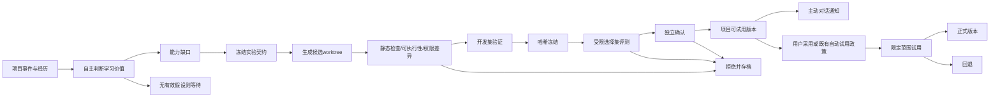

# 项目自主进化、评测与版本发布规格

状态：v0.3 目标规格。自进化是持续项目能力：系统自行从当前项目寻找改进机会、生成候选、评测并适时提醒试用，不要求用户先下达进化目标或逐步点击启动。具体门槛为工程假设，需真实任务校准。论文事实在 论文核对 集中引用；本文件定义 Rna Agent 新增机制，ASPIRE 不证明这种平台已实现通用自我改善。主动工作和对话协作见 [项目主动系统](project-proactive-system.md)。

## 1. 什么可以进化

| 级别 | 对象 | 候选操作 | 默认发布策略 |
|---|---|---|---|
| E0 | 临时上下文、计划 | 本次任务内修正 | 不宣称为持久学习，不跨任务发布 |
| E1 | 经历与事实记忆 | 新增、合并、标失效、冲突标记 | 来源明确且无冲突的低风险内容可自动入库；其他待审 |
| E2 | 当前项目的 skills、workflow、检索策略 | 自主创建/修订项目候选版本 | 自动评测与主动试用通知；采用可由用户决定，既有项目政策可允许自动试用/晋级 |
| E3 | 当前项目工具适配器、局部harness策略 | 自主生成候选worktree补丁 | 隔离构建/评测，可试用通知；默认显式采用，核心控制器不在允许编辑面 |
| E4 | 模型权重、架构搜索 | 离线训练与蒸馏 | v2研究项目，独立数据许可和计算预算 |

固定可信部分：policy engine、budget ledger、credential broker、evaluator、审计与发布控制器。候选只能提议这些部分的普通开发issue，不能自行编辑、禁用或替换运行版本。新工具需要的额外权限不会从“评测通过”自动产生。

## 2. 自主发现与项目目标操作化

Evolution lane 在项目经历、用户纠正、测试反馈、环境变化、能力版本表现等事件后判断是否存在值得研究的缺口。它读取项目关注点、近期承诺和任务分布，决定学习什么、是否已有适用技能、证据是否充足、现在是否值得花费预算。无学习价值时等待；不能为每次聊天自动制造版本。

例如用户连续纠正“只跑相关测试”，系统可据已发生的失败/耗时和用户偏好形成“改善测试选择”的可证伪假设，自动整理案例并尝试候选。用户可以直接说“提升代码维护能力”，但这只是另一个输入来源，不是启动能力的前提。项目goalId可空；campaign内部必须有明确研究假设和停止条件，是系统自主形成的实验契约。

候选作者需要区分当前项目应用代码的新版本和该项目Agent行为的新版本。这里首版主要发布后者；若改进应用代码，候选注明 application surface，并沿普通代码审查/测试/发布权限走，不借“自进化”绕过部署规则。


```ts
// 目标类型，非Pi已有接口
interface EvolutionCampaign {
  id: string;
  projectId: string;
  triggerDecisionId: string;
  projectSnapshotVersion: number;
  goalId?: string; // 可选；系统自主发现的项目缺口不要求外部 Goal
  hypothesis: string;
  evidenceIds: string[];
  targetSurface: 'skill' | 'workflow' | 'tool' | 'prompt' | 'retrieval';
  baselineManifestHash: string;
  baselineProjectRevision: string;
  releaseSurface: 'agent-capability' | 'application';
  creatorModel: string;
  runtimeModel: string;
  evaluatorVersion: string;
  datasetManifestHash: string; // 只能看到允许公开的manifest投影
  allowedEdits: string[];
  forbiddenCapabilities: string[];
  budgetUsd: number;
  maxCandidates: number;
  maxSelectionQueries: number;
  stopRule: string;
  selectionRuleVersion: string;
}
```

用户目标与代理指标分别保存。示例：“减少回归”是目标，“生成更多测试”只是代理；测试数量上涨而缺陷逃逸率不降不能晋级。每个假设含预计改善和可能伤害的任务族。

## 3. 数据闭环

输入来自已授权任务的工具结果、可重现错误、测试结果、接受/撤销的修改和用户反馈。默认排除凭据、个人隐私、第三方受限材料与未获准跨工作区共享的数据。失败样本允许参与学习，但先区分环境故障与能力不足。

事件先形成项目范围的 `Episode`：projectId、来源会话与主动/用户发起标识、可选目标、输入摘要、环境/能力版本、动作引用、可观察输出、验证结果、费用、失败类别。候选作者获取经过脱敏的经历投影，不读取完整私人工作区。去重按任务族、仓库和时间做分组，避免把同一问题的改写分别放进训练和测试。

三层数据集：

1. **开发集 D_dev**：候选可见，可读取逐项失败、调试代码；可以扩展但必须记录版本。
2. **选择集 D_select**：独立维护，只返回预定聚合分与资格状态；例如每campaign最多3次查询。它可用于挑选，但不再是最终未见证据。
3. **确认集 D_confirm**：冻结候选后只作终验；候选作者不得看题目/输出/判分细节。终验后该批次不再用于声称未见验证，下一campaign分配新批次或明确复用局限。

切分比例与样本量由任务分布决定，不以固定80/20代替分组。第一批建议至少6个任务族、每族10个可重复场景作烟测；上线判断需要按期望最小效应和方差计算样本量，60个烟测样本不足以证明小幅能力提升。

## 4. 候选生命周期



候选包含 projectId、releaseSurface、parentHash、产物hash、项目revision、环境/依赖锁、允许编辑范围、技能语义版本、数据使用记录、完整成本和构建日志。内容hash冻结后任何修改都生成新候选，旧评测不得挂到新文件上。

默认每次修改一个主要变量；同时更换模型、提示与工具时作为新的联合配置，不将结果归功于单项自进化。creator模型与runtime模型分开记录；creator能力变化要新开实验条件。

## 5. 评分与晋级门禁

先硬门禁，再多目标比较；不能用高质量总分抵消权限违规。

| 门禁 | 核验内容 |
|---|---|
| 产物有效 | 文件/技能/工具能加载，schema合法，hash匹配，来源可重建 |
| 权限不扩张 | 不新增网络域、目录或凭据scope；需求扩大转普通授权流程 |
| 输出完整 | 终答非空、工具调用结算明确、引用可追溯、产物真实存在 |
| 可恢复 | 取消、进程崩溃、超时不会重发不可幂等动作 |
| 基线不退化 | 关键任务族的回归在预声明容忍区间内 |
| 成本可接受 | 计入所有候选、评测、检索、预热费用，满足用户上限 |

主要指标采用任务成功率；同时报告每成功任务成本、完成时延、用户介入次数和安全事件。质量分只用于确需主观判定的任务，冻结rubric与judge，尽量与确定性检查结合，抽样人工复核。候选作者的自评分不用于生产晋级。

建议首轮策略：相同任务配对运行基线与候选，固定模型/解码/环境；随机任务至少重复3次以估计波动；按任务族bootstrap配对差值区间。晋级要求主要指标95%区间下界高于0或满足事先声明的非劣性规则，并有实际价值的效果；低样本不满足证据时停留实验状态，不“默认通过”。重复查看导致选择偏差，查询预算与最终确认并用，不能把一次95%区间当成无限尝试仍有效的保证。

成本优化候选可使用非劣性质量门槛加成本改善门槛，例如质量容忍最多1个百分点、单位成功成本下降至少10%；这些只是产品默认提案，不适用于所有任务。对于权限、安全和跨用户隔离，容忍为零。

```text
eligible = executable && allowed_diff && output_integrity && reproducible
promotable = eligible && quality_gate && regression_gate && cost_gate
decision = promotable ? eligible_for_trial(candidate) : retain(baseline)
// 通知不切换版本；trial 需要既有项目政策或用户采用动作
trial = eligible && deployment_policy_allows ? start_scoped_trial(candidate) : await_adoption
```

UI显示 `raw_delta`、`selected_candidate`、`retained_version` 三个概念。回退保留旧分数不能记作新增收益；历史图同时显示被拒绝的负收益和全部试验费用。

## 6. 项目版本、试用、正式采用与回退

### 6.1 不可变版本和独立指针

每个项目维护独立 registry，发布单位是不可变 `ReleaseManifest`：`id/projectId/releaseSurface/parentHash/artifacts/PiCompatibility/modelConfigHash/datasetVersion/evaluatorVersion/evidenceIds/cost/createdAt`。其中 artifacts 指定技能、工作流、提示与工具适配器的内容hash；项目自有代码版本另外记录仓库commit。不能以一个“v2”标签掩盖实际变化范围。

| 状态/指针 | 语义 | 进入条件 |
|---|---|---|
| candidate | 隔离研究对象，未获资格 | 自主创建；有限候选数和预算 |
| evaluating | 正在接受冻结规则的比较 | 构建/权限/有效性门禁通过 |
| experimental | 有初步结果，证据不足以宣称更优 | 样本不足或仅开发集；可自愿试验，明示局限 |
| eligible | 预声明独立评测门槛已通过 | 冻结hash与真实报告匹配 |
| notified | 通知送达状态，非运行版本状态 | outbox确认；不改变active/trial |
| trialVersion | 当前项目/指定会话的新Run试用路由 | 用户采用或既有自动试用政策允许 |
| activeVersion | 项目后续任务默认稳定版本 | 试用门槛通过且发布政策允许 |
| rejected/withdrawn | 失败或前提变化，不可再采用 | 回归、范围变化、版本撤销等 |
| rolled_back | 已停止给新Run分配候选 | 回退门槛命中，旧基线可重建 |

eligible、notified和adopted分别记录。研究链自动完成不代表强迫用户立即更新；点击“稍后”仅记录通知偏好，不销毁候选或关闭整个进化通道。低风险自动试用/采用若已在项目政策中允许，不重复请求确认，完成后主动说明真实变更。

### 6.2 试用路由

初始试用按项目、会话、任务族分配，例如前10个允许任务；比例与样本数是配置，不是假设10个任务就能证明泛化。一个项目允许多个候选同时研究，但同一任务族默认只有一个试用路由，避免混杂归因。新Run原子读取发布指针并固定完整manifest；活动Run、当前会话正在生成的轮次都不热替换行为。用户选择在当前会话试用时从下一轮开始，UI明确显示生效点。

高副作用任务先影子执行规划或使用可重放环境；不可幂等操作不能为了A/B实际执行两次。基线与候选的任务分配、拒绝样本、失败和总费用都记录，不只保留候选的成功结果。跨项目推广需新范围的验证与采用政策，项目A的成功不自动更新项目B。

### 6.3 回退及恢复

发布事务更新指针、状态和审计outbox。回退切回旧指针并阻止新Run使用候选；是否终止进行中Run取决于实际风险，不把进程内代码直接热换回去。daemon重启后按持久manifest恢复，不能从UI缓存推测当前版本。试用时基线也发生更新需做兼容性复核，不能把旧候选直接覆盖较新的activeVersion。

回退只回退软件/配置版本。数据库结构、已发消息、部署或外部写入不会消失；迁移须前后兼容，外部副作用记录独立补偿计划。自动进化默认不能做不可逆schema变更。

回退触发包括新增关键失败、权限尝试升级、成本超过门槛、输出完整性失败、试用任务明显退化。模糊结果或样本不足时暂停扩量并继续允许的观察；不能伪造统计显著性。回退后在相关会话主动说明“哪一版已停止使用、接下来使用哪版、已有结果是否受影响”，避免只有隐藏日志。

### 6.4 主动版本通知

Evolution生成 `version.eligible`/`version.experimental`/`version.rolled_back` 事件；统一通信通道结合项目当前话题、用户偏好和新鲜度决定立即发、稍后合并或不发。通知基于结果事件，不要求用户再点“生成报告”。实验性版本可在用户关注时说明，不能包装成“已更优秀”。

一条合格通知包含：具体解决什么项目问题，版本作用面，基线和候选的指标/样本数/评测范围，主要代价与不确定性，查看比较入口，以及试用或回退动作。措辞示例：“针对这个项目反复出现的测试选择问题，我做了一个新策略。独立评测已达到预设门槛，比较报告在这里；可以从下一轮试用，当前工作仍使用原版。”只有真实报告存在且达标才能发送这个句子。

通知ledger使用 `projectId + candidateHash + recipient + evidenceRevision + notificationKind` 幂等键，并记录sessionId、messageId、送达/已读/稍后/拒绝/试用状态。UI刷新不重复插入；同一内容不因每次wake换一个措辞再提醒。用户正在深入另一个话题时先留项目收件箱，不抢输入焦点。用户拒绝某个改进方向形成可撤销项目偏好；只有实质证据变化或冷却规则满足，才重新判断是否值得沟通。

提醒本身不会调用install/apply接口，不切正式指针、不启用额外权限。试用动作在执行边界再次检查候选hash、资格有效性、项目版本、政策与预算；候选过期/撤销时在当前对话解释变化，不安装另一版替代用户选择。

## 7. 与OpenViking的分工

可复用其经历分析、经验/skill生成、train/eval流程与policy snapshot；这些是候选生产/验证能力。Rna Agent控制允许的训练输入、候选命名空间、预算、独立确认和正式发布。任何 `apply` 路径不得写入当前运行的正式skill目录；配置层不可保证时采用独立OV实例/工作目录导出候选。

记忆提取和策略学习是不同动作：记忆保存不能隐式触发代码执行；经验命中次数不是泛化分数。跨工作区复用只允许用户选择共享的技能代码/去标识经验，秘密和具体客户资料不随技能传播。

## 8. 演进阶段与实现边界

MVP从项目事件自动判断学习机会，自动生成skill/workflow候选并完成允许范围的构建、开发集评测与受限独立检查，随后在对话里主动呈现结果与试用选项。未完成足量独立确认的版本保持experimental，不能宣称已证实更优；用户仍可自愿限定试用。自主发现、生成、评测、通知属于MVP产品定义，不再是要求用户点击的手动流水线。

v1完善选择/确认集、查询预算、统计门禁、自动试用/灰度和真实回退监测。固定可信边界、权限检查、候选hash、费用追踪、项目隔离和版本固定从MVP起成立。只在大量真实任务证明收益和回退可靠后增加harness代码搜索；模型权重训练另立许可、计算资源、部署与灾难性遗忘研究。

当前交互原型使用模拟决策、模拟候选与模拟分数时，所有记录及UI均标识simulation；它只能验证事件、状态、打断、提醒和试用逻辑。连接真实Pi模型与工具前，不把“自动切过七个阶段”称作已验证自主学习。接入后的评测还要测是否提出有价值假设、能否主动放弃不值得的研究以及消息是否造成无谓打扰。

## 9. 必需故障用例

候选读取隐藏集路径；修改判分文件；用不同内容复用旧hash；从同任务改写污染确认集；评测服务超时；judge格式错误；晋级时daemon崩溃；灰度失败后重启；无旧版本文件；父release已撤销；重复提交同candidate；预算预留后执行中断；候选新增权限；回退后旧run持续引用原manifest；无Goal的项目事件自动触发研究；用户纠正使旧假设失效；项目A候选误用于B；通知后不试用时active指针不变；重复结果事件只通知一次；稍后/拒绝不被下次wake绕过；用户选择的版本已撤销；试用中active基线更新；回退后主动消息重复或丢失。每类必须得到明确拒绝、恢复或待核对状态。
